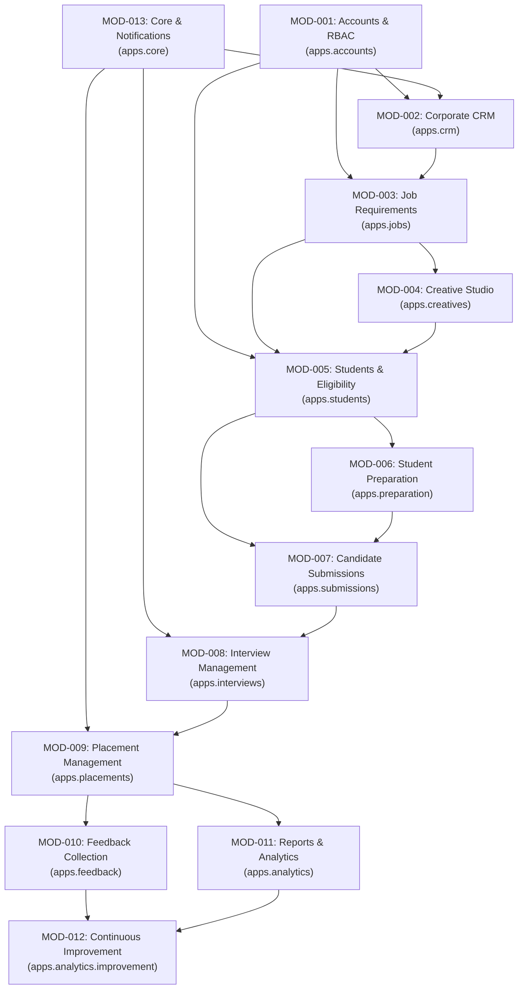

# 03 — Module and Workflow Inventory
**GQT HRMS & Recruitment CRM Platform**  
**Document Status:** Phase 0 Documentation — Verified Baseline (Not Approved for Implementation)  
**Document ID:** GQT-DOC-P0-003  
**Prepared:** 2026-11-03  
**Author:** Software Architecture & QA Working Group  

---

## 1. Executive Summary

This inventory establishes the comprehensive architectural and domain boundary specifications for the 13 modular applications comprising the first-release scope of the **GQT HRMS & Recruitment CRM Platform**. 

Each module represents a discrete, loosely coupled domain service implemented under the Django REST Framework backend (`/api/v1/`) and supported by dedicated React + TypeScript view layers. Conventional employee HR functions (payroll, employee attendance, staff leaves, internal appraisals) are strictly excluded from this inventory.

---

## 2. Global Module Dependency Graph

The recruitment CRM lifecycle operates as a strict directional state progression from corporate partner acquisition to post-joining continuous learning feedback loops.

---

## 3. High-Level Module Summary Register

| Module ID | App Name | Domain Purpose | API Prefix | Primary Roles | Core Model Count |
|:---|:---|:---|:---|:---|:---:|
| **MOD-001** | `apps.accounts` | User identity, session lifecycle, roles, RBAC permissions, audit logging | `/api/v1/auth/` | Admin, All Staff, Students | 4 |
| **MOD-002** | `apps.crm` | Corporate directory, recruiter contacts, multi-channel outreach, follow-ups | `/api/v1/crm/` | Calling Exec, Placement Officer, Head | 5 |
| **MOD-003** | `apps.jobs` | Structured JD collection, 5-point verification checklist, formal approval gate | `/api/v1/jobs/` | Placement Officer, Placement Head | 4 |
| **MOD-004** | `apps.creatives` | Design asset requests, multi-channel creative versioning, review & approval | `/api/v1/creatives/` | Designer, Reviewer, Placement Head | 3 |
| **MOD-005** | `apps.students` | Student registration, profile & resume vaults, eligibility engine, cohort lock | `/api/v1/students/` | Students, Placement Officer, Head | 5 |
| **MOD-006** | `apps.preparation` | Resume scoring, aptitude/tech tests, grooming sessions, readiness certification | `/api/v1/preparation/` | Trainer, Evaluator, Placement Head | 6 |
| **MOD-007** | `apps.submissions` | Master candidate roster assembly, SHA-256 package hash, recruiter dispatch | `/api/v1/submissions/` | Placement Officer, Placement Head | 3 |
| **MOD-008** | `apps.interviews` | Shortlist intake, multi-round scheduling, attendance tracking, results | `/api/v1/interviews/` | Interview Coordinator, Officer | 5 |
| **MOD-009** | `apps.placements` | Results intake, offer letter vault, candidate acceptance, joining status audit | `/api/v1/placements/` | Placement Head, Officer, Student | 4 |
| **MOD-010** | `apps.feedback` | 360° feedback loops (Student, Corporate Recruiter, Placement Trainer) | `/api/v1/feedback/` | Student, Recruiter, Trainer, Auditor | 3 |
| **MOD-011** | `apps.analytics` | Aggregated placement KPIs, conversion funnels, CSV exports with sanitization | `/api/v1/reports/` | Placement Head, Admin, Auditor | 3 |
| **MOD-012** | `apps.analytics.improvement` | Remedial training planning, skill-gap analysis, recruitment cycle reviews | `/api/v1/continuous-improvement/` | Placement Head, Trainer, Auditor | 4 |
| **MOD-013** | `apps.core` | System telemetry, audit logs, unified notification hub, background workers | `/api/v1/notifications/` | System, All Users | 3 |

---

## 4. Detailed Module Specifications

### MOD-001: Accounts, Identity & Role-Based Access Control (`apps.accounts`)
- **Domain Purpose:** Centralized authentication authority, session lifecycle management via secure HttpOnly JWT cookies, cryptographic password hashing (Argon2), and deny-by-default role authorization.
- **Primary Users:** System Administrator (`ADMIN`), Placement Head (`PLACEMENT_HEAD`), Placement Staff, Enrolled Students (`STUDENT`).
- **Core Records & Models:**
  - `User`: Custom UUIDv4 user entity with normalized email login identifier, active status, and phone number.
  - `Role`: Standardized role catalogs (`ADMIN`, `PLACEMENT_HEAD`, `PLACEMENT_OFFICER`, `HR_RELATIONSHIP_MGR`, `CREATIVE_DESIGNER`, `TRAINER`, `EVALUATOR`, `STUDENT`, `AUDITOR`).
  - `UserRole`: User-to-role assignment with assignment timestamp and assigning administrator ID.
  - `AuditLog`: Immutable record of authentication events, privilege escalations, and security state changes.
- **CRAP / CRUD Actions:**
  - *Create:* Register staff user, issue activation invitation, create authentication session.
  - *Read:* Query self-profile, list active staff directory, inspect audit logs.
  - *Update:* Update user profile, rotate password, modify assigned roles (Admin only).
  - *Approve / Deactivate:* Deactivate compromised credentials, invalidate active JWT refresh tokens.
  - *Publish:* Not applicable.
- **Allowed Workflow State Transitions:**
  - User Status: `PENDING_ACTIVATION` &rarr; `ACTIVE` &rarr; `SUSPENDED` / `DEACTIVATED`.
  - Session Status: `ISSUED` &rarr; `REFRESHED` &rarr; `BLACKLISTED` / `EXPIRED`.
- **Key Validation Rules:**
  1. Emails must be strictly lowercased and unique across all active/inactive users.
  2. Passwords must adhere to minimum 12-character entropy with Argon2 hashing.
  3. No role self-assignment or privilege escalation permitted.
  4. Authentication cookies must enforce `HttpOnly`, `SameSite=Lax`, and `Secure=True` in production.
  5. Multi-factor / mobile OTP validation required for sensitive administrative workflows.
- **Required Audit Events:** `AUTH_LOGIN_SUCCESS`, `AUTH_LOGIN_FAILURE`, `AUTH_LOGOUT`, `ROLE_ASSIGNED`, `ROLE_REVOKED`, `PASSWORD_RESET_REQUESTED`.
- **Notifications & Reminders:** Password reset token delivery, unusual login activity alerts.
- **Failure & Recovery Scenarios:**
  - Token theft or replay: Invalidate refresh family and force re-authentication.
  - Brute-force attacks: Rate limiting via DRF throttling (`5/minute` for login endpoints).
- **Dependencies:** None (foundation module).
- **API Prefix:** `/api/v1/auth/`
- **Acceptance Criteria:**
  - Zero tokens stored in `localStorage` or `sessionStorage`.
  - All protected endpoints return HTTP 401/403 when unauthenticated or lacking requisite role.

---

### MOD-002: Corporate CRM & HR Directory (`apps.crm`)
- **Domain Purpose:** Track enterprise hiring partners, manage corporate HR contacts, coordinate multi-channel calling outreach (target 100+ touchpoints/day), and schedule follow-ups.
- **Primary Users:** Calling Executive (`HR_RELATIONSHIP_MGR`), Placement Officer, Placement Head.
- **Core Records & Models:**
  - `Company`: Corporate entity with canonical domain, industry category, tier, normalization name, and partnership status.
  - `HRContact`: Individual recruiter record with verified email, direct dial, designation, and LinkedIn profile.
  - `OutreachLog`: Record of outreach touchpoint (Call, Email, WhatsApp, LinkedIn, In-Person) with duration and response disposition.
  - `FollowUp`: Actionable task scheduled for a specific recruiter with due timestamp, priority, and assigned staff member.
  - `CompanyReconciliationRecord`: Historical reconciliation tracking active hiring engagement.
- **CRAP Actions:**
  - *Create:* Log target company, add recruiter contact, log outreach activity, schedule follow-up.
  - *Read:* View company profile, filter HR directory, review personal outreach quotas and overdue follow-up queues.
  - *Update:* Edit recruiter details, reschedule follow-up, update partnership tier.
  - *Approve:* Promote prospect to `ACTIVE_HIRING_PARTNER`.
  - *Publish:* Broadcast hiring partner addition to placement staff dashboard.
- **Workflow State Transitions:**
  - Company: `LEAD` &rarr; `CONTACTED` &rarr; `ENGAGED` &rarr; `ACTIVE_HIRING_PARTNER` &rarr; `DORMANT` / `BLACKLISTED`.
  - Follow-Up: `SCHEDULED` &rarr; `COMPLETED` / `RESCHEDULED` / `OVERDUE` / `CANCELLED`.
- **Key Validation Rules:**
  1. Duplicate detection: Rejects company creation if domain name or normalized name collides.
  2. HR contact emails and phone numbers must be unique within the same corporate entity.
  3. Outreach log requires mandatory channel selection, disposition, and non-empty notes.
  4. Follow-up due dates cannot be scheduled in the past.
- **Required Audit Events:** `COMPANY_CREATED`, `COMPANY_DUPLICATE_FLAGGED`, `HR_CONTACT_MODIFIED`, `FOLLOWUP_ESCALATED`.
- **Notifications & Reminders:** Daily 09:00 AM follow-up agenda; SLA escalation notification when a follow-up is overdue >24 hours.
- **Failure Scenarios:** Recruiter change of employment: Soft-deactivate contact while preserving historical outreach records.
- **Dependencies:** `MOD-001` (auth), `MOD-013` (notifications).
- **API Prefix:** `/api/v1/crm/`
- **Acceptance Criteria:**
  - Automated duplicate warning triggered when domain matches existing company.
  - Daily touchpoint counter accurately aggregates distinct outreach activities per executive.

---

### MOD-003: Job Requirement Management (`apps.jobs`)
- **Domain Purpose:** Intake structured job descriptions, enforce the 5-point verification checklist, and execute the internal approval gate locking JDs prior to creative design or student announcement.
- **Primary Users:** Placement Officer (Intake & Verification), Placement Head (Formal Approval).
- **Core Records & Models:**
  - `JobRequirement`: Structured position details (role title, domain, CTC range, location, work mode, bond details, deadlines).
  - `JobChecklistItem`: Verification checklist instance for each of the 5 criteria:
    1. `ELIGIBILITY`: Academic branch, CGPA, and backlog rules.
    2. `SALARY_AUTHENTICITY`: Fixed vs variable pay clarity, stipend transparency.
    3. `COMPANY_AUTHENTICITY`: Legitimate registration, corporate email verification.
    4. `INTERVIEW_PROCESS`: Defined selection stages (Aptitude, Coding, Technical, HR).
    5. `REGISTRATION_DEADLINE`: Feasible student notice window (min 48 hours).
  - `JobApprovalDecision`: Formal sign-off record locking JD from further mutation.
  - `JobRevisionLog`: Change history tracking amendments requested during review.
- **CRAP Actions:**
  - *Create:* Draft job requirement, populate 10 structured fields.
  - *Read:* Inspect job specs, view checklist verification matrix.
  - *Update:* Amend draft details, update checklist item status (`PENDING` &rarr; `VERIFIED` / `REJECTED`).
  - *Approve:* Placement Head signs off (`VERIFIED` &rarr; `APPROVED`), locking record.
  - *Publish:* Release approved requirement to Creative Studio (`MOD-004`).
- **Workflow State Transitions:**
  - `DRAFT` &rarr; `PENDING_VERIFICATION` &rarr; `UNDER_REVIEW` &rarr; `VERIFIED` &rarr; `APPROVED` (or `CHANGES_REQUESTED` / `REJECTED`).
- **Key Validation Rules:**
  1. Minimum CTC cannot exceed Maximum CTC.
  2. Registration deadline must be at least 48 hours in advance of drive date.
  3. Approval is strictly impossible if any of the 5 checklist items is not in `VERIFIED` status.
  4. Only `PLACEMENT_HEAD` or `ADMIN` roles may approve a job requirement.
  5. Post-approval modifications are strictly rejected by database constraints; requires explicit revocation.
- **Required Audit Events:** `JOB_DRAFT_CREATED`, `CHECKLIST_ITEM_VERIFIED`, `JOB_APPROVED_AND_LOCKED`, `JOB_REJECTED`.
- **Notifications & Reminders:** Notification to Placement Head when all 5 items pass verification; notification to drafting officer if changes are requested.
- **Dependencies:** `MOD-001`, `MOD-002` (company link), `MOD-013`.
- **API Prefix:** `/api/v1/jobs/`
- **Acceptance Criteria:**
  - Attempting to approve a job with 4 verified items and 1 pending item returns HTTP 400 Bad Request.
  - Locked jobs reject all `PUT`/`PATCH` mutation attempts.

---

### MOD-004: Creative Studio & Asset Management (`apps.creatives`)
- **Domain Purpose:** Manage marketing and student communication creative requests, multi-channel asset versioning (Flyer, WhatsApp Card, Banner), 4-point design checks, and publication approvals.
- **Primary Users:** Placement Officer (Requester), Creative Designer (`CREATIVE_DESIGNER`), Creative Reviewer (`CREATIVE_REVIEWER`), Placement Head (Approver).
- **Core Records & Models:**
  - `CreativeRequest`: Asset specification linked to an approved `JobRequirement`.
  - `CreativeAssetVersion`: Versioned uploaded graphic asset (`v1`, `v2`, `v3`) with format, resolution, and SHA-256 hash.
  - `DesignChecklist`: Verification of 4 design standards:
    1. Flyer text accuracy (Role, CTC, Eligibility match JD).
    2. Official GQT and company logo usage.
    3. Scannable registration QR code.
    4. Verified links and institutional contact info.
  - `CreativeApprovalDecision`: Review sign-off allowing announcement dispatch.
- **CRAP Actions:**
  - *Create:* Initiate creative request, upload design asset version.
  - *Read:* Preview uploaded assets, inspect design checklist state.
  - *Update:* Request revision with annotated feedback, re-upload revision.
  - *Approve:* Sign off on design checklist and authorize asset publication.
  - *Publish:* Mark asset pack as ready for Student Announcement (`MOD-005`).
- **Workflow State Transitions:**
  - `REQUESTED` &rarr; `IN_PROGRESS` &rarr; `SUBMITTED_FOR_REVIEW` &rarr; `REVISION_REQUESTED` &rarr; `APPROVED` &rarr; `PUBLISHED`.
- **Key Validation Rules:**
  1. Asset uploads restricted to PNG, JPEG, and WebP (SVG rejected to prevent stored XSS attacks).
  2. File size capped at 10MB per asset.
  3. Binary magic bytes verified on upload.
  4. Asset approval requires all 4 checklist points to be passed.
- **Required Audit Events:** `CREATIVE_REQUESTED`, `ASSET_VERSION_UPLOADED`, `DESIGN_REVISION_REQUESTED`, `CREATIVE_APPROVED`.
- **Notifications:** Designer alerted on new request; Reviewer alerted on submission; Requester alerted on approval.
- **Dependencies:** `MOD-001`, `MOD-003` (must link to approved job), `MOD-013`.
- **API Prefix:** `/api/v1/creatives/`
- **Acceptance Criteria:**
  - Uploading an SVG or corrupted image file returns validation error.
  - Version increments strictly monotonically (`v1` &rarr; `v2`).

---

### MOD-005: Student Management & Eligibility Engine (`apps.students`)
- **Domain Purpose:** Ingest student profiles, maintain private PDF resume vaults, execute deterministic eligibility evaluations across academic criteria, and assemble candidate cohorts.
- **Primary Users:** Student (`STUDENT`), Placement Officer, Placement Head.
- **Core Records & Models:**
  - `StudentProfile`: Master student entity (Roll number, Branch, Degree, Grad Year, CGPA, Backlogs, Contact).
  - `StudentResume`: Versioned PDF resume with isolated storage path and SHA-256 integrity digest.
  - `JobPublication`: Public broadcast record of an approved job with linked creatives.
  - `EligibilityEvaluation`: Deterministic snapshot evaluating a student against a specific `JobRequirement`.
  - `CandidateCohort`: Finalized, locked roster of students eligible for recruitment drive submission.
- **CRAP Actions:**
  - *Create:* Candidate self-registration, resume upload, evaluate eligibility.
  - *Read:* Candidate views eligible jobs; staff inspects candidate database and eligibility audit logs.
  - *Update:* Student updates contact/resume; staff logs authorized manual eligibility override.
  - *Approve / Lock:* Placement Head locks the final candidate cohort.
  - *Publish:* Broadcast job opportunity across student channels.
- **Workflow State Transitions:**
  - Evaluation: `PENDING` &rarr; `ELIGIBLE` / `INELIGIBLE` / `MANUALLY_OVERRIDDEN`.
  - Cohort: `DRAFT` &rarr; `FINALIZED` &rarr; `LOCKED`.
- **Key Validation Rules:**
  1. Resumes must be valid PDFs (`%PDF-` header check), max 5MB.
  2. Strict object-level authorization: Students can only view/download their own resumes.
  3. Eligibility engine rules must be deterministic: Branch `IN` allowed list, CGPA `>=` min_cgpa, Backlogs `<=` max_backlogs.
  4. Manual overrides require mandatory justification text and recording of staff user ID.
  5. Locked cohorts cannot be modified without formal unlocking audit.
- **Required Audit Events:** `STUDENT_REGISTERED`, `RESUME_UPLOADED`, `ELIGIBILITY_EVALUATED`, `ELIGIBILITY_OVERRIDDEN`, `COHORT_LOCKED`.
- **Notifications:** Student notified of matching job; student notified of cohort selection or ineligibility reason.
- **Dependencies:** `MOD-001`, `MOD-003`, `MOD-004`, `MOD-013`.
- **API Prefix:** `/api/v1/students/`
- **Acceptance Criteria:**
  - Ineligible student attempting to register for a drive receives detailed deterministic breakdown of failed rules.
  - Student A requesting `/api/v1/students/resumes/{id_of_student_B}/` receives HTTP 403 Forbidden.

---

### MOD-006: Student Preparation & Readiness Gate (`apps.preparation`)
- **Domain Purpose:** Deliver multi-dimensional student training, track assessment scores, conduct 1-on-1 mock interviews with rubric evaluations, and enforce the Step 23 Placement Readiness Certification gate.
- **Primary Users:** Placement Trainer (`TRAINER`), Mock Evaluator (`EVALUATOR`), Placement Head.
- **Core Records & Models:**
  - `ResumeReview`: Detailed trainer feedback scoring student resume across formatting, technical depth, and impact.
  - `AssessmentTest`: Aptitude and technical coding test catalog with time limits and pass marks.
  - `AssessmentAttempt`: Student test attempt with raw score, percentage, and pass/fail outcome.
  - `TrainingSession`: Workshop or grooming session record (Communication, Soft Skills, Body Language).
  - `MockInterview`: 1-on-1 mock interview session tracking Technical and HR performance.
  - `PlacementReadinessCertification`: Formal certification record (Step 23) qualifying candidate for corporate dispatch.
- **CRAP Actions:**
  - *Create:* Schedule mock interview, log test results, submit rubric scores.
  - *Read:* Review candidate scorecard and historical preparation radar chart.
  - *Update:* Amend rubric feedback, log re-attempt assessment.
  - *Approve:* Placement Head certifies student as `APPROVED_FOR_DRIVES`.
  - *Publish:* Release readiness certification to candidate submission pool.
- **Workflow State Transitions:**
  - Candidate Readiness: `NOT_EVALUATED` &rarr; `TRAINING_IN_PROGRESS` &rarr; `REMEDIAL_REQUIRED` &rarr; `READY_FOR_REVIEW` &rarr; `CERTIFIED_ACTIVE` / `DISQUALIFIED`.
- **Key Validation Rules:**
  1. Assessment scores cannot exceed test maximum marks.
  2. Mock interview scorecards enforce weighted rubric sums (Technical: 25 pts, Communication: 15 pts).
  3. Placement readiness certification strictly requires: passed technical assessment, passed mock interview, and verified resume.
  4. Candidate submission module (`MOD-007`) rejects candidates lacking active certification.
- **Required Audit Events:** `ASSESSMENT_COMPLETED`, `MOCK_INTERVIEW_SCORED`, `READINESS_CERTIFIED`, `READINESS_REVOKED`.
- **Notifications:** Candidate alerted on upcoming mock interview schedule; candidate alerted on readiness status.
- **Dependencies:** `MOD-001`, `MOD-005`, `MOD-013`.
- **API Prefix:** `/api/v1/preparation/`
- **Acceptance Criteria:**
  - Attempting to certify a candidate who failed the mock interview raises a business logic validation error.

---

### MOD-007: Candidate Submissions & Profile Dispatch (`apps.submissions`)
- **Domain Purpose:** Package certified candidates into a standardized master Excel roster, bundle verified resumes, compute cryptographic package digests, and log profile dispatch to corporate recruiters.
- **Primary Users:** Placement Officer, Placement Head.
- **Core Records & Models:**
  - `SubmissionPackage`: Container grouping candidates submitted to a specific `JobRequirement`.
  - `SubmissionItem`: Candidate record within package, referencing certified resume version.
  - `DispatchLog`: Audit record of profile transmission to recruiter (recipient email, timestamp, package hash, tracking ID).
- **CRAP Actions:**
  - *Create:* Assemble candidate submission pool, generate master Excel spreadsheet.
  - *Read:* Download generated roster, view dispatch audit history.
  - *Update:* Remove ineligible candidate prior to dispatch.
  - *Approve:* Placement Head signs off on submission dispatch package.
  - *Publish / Dispatch:* Execute atomic dispatch logging and send package to corporate recruiter.
- **Workflow State Transitions:**
  - Package: `DRAFT_ASSEMBLY` &rarr; `READY_FOR_SIGN_OFF` &rarr; `APPROVED` &rarr; `DISPATCHED` &rarr; `ACKNOWLEDGED`.
- **Key Validation Rules:**
  1. Candidate must possess active Step 23 readiness certification.
  2. Candidate can only be submitted once to the same job requirement (unique constraint on `job` + `student`).
  3. Master Excel roster must be generated dynamically with cell-sanitization against formula injection.
  4. Cryptographic SHA-256 digest must be calculated and stored on generation.
  5. Dispatch concurrency protection: Row-level lock (`select_for_update`) during dispatch execution.
- **Required Audit Events:** `SUBMISSION_PACKAGE_CREATED`, `MASTER_ROSTER_GENERATED`, `PROFILES_DISPATCHED_TO_HR`, `HR_ACKNOWLEDGED_PACKAGE`.
- **Notifications:** Placement Head notified of package ready for review; Corporate recruiter sent dispatch notification.
- **Dependencies:** `MOD-001`, `MOD-003`, `MOD-005`, `MOD-006`, `MOD-013`.
- **API Prefix:** `/api/v1/submissions/`
- **Acceptance Criteria:**
  - Submitting candidate twice to the same drive throws duplicate constraint error.
  - Generated Excel file hash matches stored SHA-256 in `SubmissionPackage`.

---

### MOD-008: Interview Management & Round Tracking (`apps.interviews`)
- **Domain Purpose:** Ingest recruiter shortlists, schedule multi-stage interviews, send automated reminders, log candidate attendance, record round results, and track recruiter follow-ups.
- **Primary Users:** Interview Coordinator (`EVALUATOR` / `PLACEMENT_OFFICER`), Students.
- **Core Records & Models:**
  - `RecruiterShortlist`: List of candidates shortlisted by company from submitted package.
  - `InterviewDrive`: Scheduled placement event with venue/link, drive dates, and stages.
  - `InterviewSlot`: Candidate-specific schedule (Date, Time, Stage, Meeting URL, Instructions).
  - `InterviewAttendance`: Candidate confirmation (`CONFIRMED`, `DECLINED`) and actual occurrence (`CONDUCTED`, `ABSENT`).
  - `InterviewRoundResult`: Stage outcome (Aptitude, Coding, Technical, HR) with evaluator feedback.
- **CRAP Actions:**
  - *Create:* Upload corporate shortlist, schedule interview rounds, record round evaluations.
  - *Read:* Candidate views assigned slot; staff monitors live round progress dashboard.
  - *Update:* Reschedule slot, record attendance status, log HR follow-up note.
  - *Approve:* Advance candidate to next interview stage.
  - *Publish:* Release interview invitations to candidates.
- **Workflow State Transitions:**
  - Attendance: `PENDING` &rarr; `CONFIRMED` / `DECLINED` &rarr; `CONDUCTED` / `ABSENT` / `RESCHEDULED`.
  - Stage Result: `IN_PROGRESS` &rarr; `CLEARED` &rarr; `ADVANCED` (or `REJECTED` / `ON_HOLD`).
- **Key Validation Rules:**
  1. Slots cannot overlap for the same candidate across different active drives.
  2. Internal evaluator notes must be stripped from candidate-facing API serializers.
  3. Reminder workers must enforce idempotent execution (`skip_locked=True`).
- **Required Audit Events:** `SHORTLIST_INGESTED`, `INTERVIEW_SCHEDULED`, `ATTENDANCE_RECORDED`, `ROUND_RESULT_LOGGED`.
- **Notifications & Reminders:** Automated reminders dispatched at 24 hours, 2 hours, and 30 minutes prior to interview slot.
- **Dependencies:** `MOD-001`, `MOD-007`, `MOD-013`.
- **API Prefix:** `/api/v1/interviews/`
- **Acceptance Criteria:**
  - Candidate viewing interview endpoint never receives evaluator internal comments.
  - Automated reminder worker never sends duplicate emails for the same reminder trigger.

---

### MOD-009: Placement Management & Offer Auditing (`apps.placements`)
- **Domain Purpose:** Ingest corporate final selections, upload and vault official offer letters, track student offer acceptance/rejection, and conduct post-joining audits.
- **Primary Users:** Placement Head, Placement Officer, Student.
- **Core Records & Models:**
  - `PlacementResult`: Final selection record linked to candidate and job requirement.
  - `OfferLetter`: Encrypted/private PDF offer document with CTC breakdown and validity deadline.
  - `OfferAcceptance`: Student response (`ACCEPTED`, `DECLINED`) with signed acknowledgement.
  - `JoiningStatusAudit`: Formal verification of joining outcome (`JOINED`, `NOT_JOINED`, `DEFERRED`) with reason documentation.
- **CRAP Actions:**
  - *Create:* Ingest selection list, upload offer letter, log joining audit.
  - *Read:* Candidate views offer letter; staff reviews placement conversion reports.
  - *Update:* Student records acceptance decision; staff records deferred joining date.
  - *Approve:* Placement Head verifies and closes placement record.
  - *Publish:* Broadcast verified placement achievement to public/institutional channels.
- **Workflow State Transitions:**
  - Offer Status: `OFFER_ISSUED` &rarr; `PENDING_RESPONSE` &rarr; `ACCEPTED` / `DECLINED` / `EXPIRED`.
  - Joining Status: `AWAITING_JOINING` &rarr; `JOINED` / `NOT_JOINED` / `DEFERRED`.
- **Key Validation Rules:**
  1. Offer letters can only be uploaded for candidates marked in `SELECTED` status.
  2. Offer letters stored strictly in private media with authenticated streaming; direct public URLs prohibited.
  3. Acceptance decision is immutable once submitted by student.
  4. Deferred joining status requires mandatory revised joining date and approval notes.
- **Required Audit Events:** `SELECTION_RECORDED`, `OFFER_UPLOADED`, `OFFER_ACCEPTED`, `OFFER_DECLINED`, `JOINING_STATUS_VERIFIED`.
- **Notifications:** Student alerted immediately upon offer upload; Placement Officer alerted upon student acceptance/decline.
- **Dependencies:** `MOD-001`, `MOD-008`, `MOD-013`.
- **API Prefix:** `/api/v1/placements/`
- **Acceptance Criteria:**
  - Non-selected student cannot access offer letter upload or viewing endpoints.
  - Offer download requires valid session and ownership check.

---

### MOD-010: Feedback Collection (`apps.feedback`)
- **Domain Purpose:** Capture structured 360° qualitative and quantitative feedback from Candidates, Corporate Recruiters, and Placement Trainers to drive system-wide continuous improvement.
- **Primary Users:** Student, Corporate Recruiter, Placement Trainer, Compliance Officer (`AUDITOR`).
- **Core Records & Models:**
  - `StudentInterviewFeedback`: Candidate's evaluation of interview difficulty, questions asked, and process fairness.
  - `RecruiterFeedback`: Corporate partner ratings on student technical competency, communication, and overall drive satisfaction.
  - `TrainerFeedback`: Trainer assessments of candidate interview readiness and skill gap observations.
- **CRAP Actions:**
  - *Create:* Submit feedback response.
  - *Read:* Inspect aggregated feedback analytics (with k-anonymity masking for students).
  - *Update:* Not permitted (feedback is append-only).
  - *Approve / Publish:* Auditor reviews feedback summaries for curriculum reviews.
- **Workflow State Transitions:** `PENDING_SUBMISSION` &rarr; `SUBMITTED` &rarr; `AGGREGATED`.
- **Key Validation Rules:**
  1. Rating scores strictly bounded between 1 and 5.
  2. Anonymous student submissions must completely mask student user IDs in analytical queries.
  3. Single submission per participant per placement drive.
- **Required Audit Events:** `FEEDBACK_SUBMITTED`, `FEEDBACK_REPORT_GENERATED`.
- **Notifications:** Automated feedback survey dispatch 2 hours following drive completion.
- **Dependencies:** `MOD-001`, `MOD-008`, `MOD-009`, `MOD-013`.
- **API Prefix:** `/api/v1/feedback/`
- **Acceptance Criteria:**
  - Student feedback marked `is_anonymous=True` never returns student identifier in API responses.

---

### MOD-011: Reports & Analytics (`apps.analytics`)
- **Domain Purpose:** Compute placement KPIs, generate recruitment conversion funnels, track executive calling performance, and provide formula-injection sanitized CSV/PDF data exports.
- **Primary Users:** Placement Head, System Administrator, Compliance Officer (`AUDITOR`).
- **Core Records & Models:**
  - `DailyAnalyticsSnapshot`: Pre-computed daily recruitment CRM metrics for high-speed dashboard loading.
  - `PlacementFunnelMetric`: Conversion tracking from Registered &rarr; Certified &rarr; Submitted &rarr; Shortlisted &rarr; Selected &rarr; Joined.
  - `ReportExportJob`: Background export job tracking CSV/PDF generation with signed temporary download URL.
- **CRAP Actions:**
  - *Create:* Request report export, trigger analytics snapshot rebuild.
  - *Read:* View interactive dashboards, download exported data.
  - *Update / Approve / Publish:* Not applicable.
- **Key Validation Rules:**
  1. CSV export cells starting with `=`, `+`, `-`, `@`, `\t`, `\r` must be escaped with a prepended single quote (`'`).
  2. Date ranges in analytical queries cannot exceed 3 years in a single synchronous query.
  3. Export access restricted to `PLACEMENT_HEAD`, `ADMIN`, and `AUDITOR` roles.
- **Required Audit Events:** `REPORT_VIEWED`, `DATA_EXPORT_GENERATED`.
- **Dependencies:** `MOD-001` through `MOD-010`.
- **API Prefix:** `/api/v1/reports/`
- **Acceptance Criteria:**
  - Exported CSV containing a student name `=cmd|' /C calc'!A0` is escaped to `'=cmd|' /C calc'!A0`.

---

### MOD-012: Continuous Improvement Hub (`apps.analytics.improvement`)
- **Domain Purpose:** Analyze recruitment cycle outcomes, map skill gaps identified in corporate feedback, formulate remedial training plans, and track institutional curriculum revisions.
- **Primary Users:** Placement Head, Placement Trainer, System Administrator.
- **Core Records & Models:**
  - `RecruitmentCycleReview`: Post-mortem analysis of completed recruitment season or specific mega-drive.
  - `SkillGapMatrix`: Aggregated matrix of student deficiencies identified across interview stages.
  - `RemedialTrainingPlan`: Structured curriculum intervention targeting identified technical or soft-skill weaknesses.
  - `CurriculumImprovementLog`: Formal recommendations forwarded to training faculty.
- **CRAP Actions:**
  - *Create:* Formulate remedial training plan, log skill gap insight.
  - *Read:* Review cycle review reports and training effectiveness metrics.
  - *Update:* Update remedial plan progress, record intervention results.
  - *Approve:* Placement Head signs off on continuous improvement roadmap.
- **Workflow State Transitions:** `IDENTIFIED` &rarr; `PLAN_FORMULATED` &rarr; `EXECUTING` &rarr; `EVALUATED` &rarr; `ARCHIVED`.
- **Required Audit Events:** `IMPROVEMENT_CYCLE_INITIATED`, `REMEDIAL_PLAN_APPROVED`.
- **Dependencies:** `MOD-006`, `MOD-010`, `MOD-011`.
- **API Prefix:** `/api/v1/continuous-improvement/`
- **Acceptance Criteria:**
  - Remedial training plan correctly links to underlying skill gap matrix data points.

---

### MOD-013: Core Infrastructure, Audit & Notifications (`apps.core`)
- **Domain Purpose:** Centralized application infrastructure, system-wide telemetry, correlation ID propagation, global notification center, and Celery background task coordination.
- **Primary Users:** System, All Authenticated Users.
- **Core Records & Models:**
  - `Notification`: In-app and multi-channel alert record with read status and action URL.
  - `SystemHealthCheck`: Diagnostic telemetry logging database, cache, and worker availability.
  - `GlobalAuditTrail`: Centralized, append-only security log for high-compliance auditing.
- **CRAP Actions:**
  - *Create:* Dispatch notification, log audit entry.
  - *Read:* User queries notification inbox; admin inspects system telemetry.
  - *Update:* Mark notification as read.
  - *Approve / Publish:* Not applicable.
- **Key Validation Rules:**
  1. Global audit logs are strictly append-only (Django model overrides `delete()` and `update()` to raise exceptions).
  2. Notifications must enforce user-specific object isolation.
  3. Correlation IDs (`X-Correlation-ID`) must be injected into all request contexts and structured log entries.
- **Required Audit Events:** `SYSTEM_ALERT_DISPATCHED`, `AUDIT_LOG_ARCHIVED`.
- **Dependencies:** Foundation module (used by all other apps).
- **API Prefix:** `/api/v1/notifications/`
- **Acceptance Criteria:**
  - Attempting to call `.delete()` on a `GlobalAuditTrail` record raises `PermissionDenied`.

---

## 5. Frontend Route and Module Inventory

| Module ID | Frontend Route | Page Component | Protected Roles |
|:---|:---|:---|:---|
| **MOD-001** | `/login` | `LoginPage.tsx` | Public |
| **MOD-001** | `/student/login` | `StudentLoginPage.tsx` | Public |
| **MOD-001** | `/admin/login` | `AdminLoginPage.tsx` | Public |
| **MOD-001** | `/settings/users` | `UserManagementPage.tsx` | `ADMIN` |
| **MOD-002** | `/crm/companies` | `CompaniesPage.tsx` | Placement Staff, Admin |
| **MOD-002** | `/crm/companies/:id` | `CompanyDetailPage.tsx` | Placement Staff, Admin |
| **MOD-002** | `/crm/contacts` | `ContactsPage.tsx` | Placement Staff, Admin |
| **MOD-002** | `/crm/outreach` | `OutreachPage.tsx` | Placement Staff, Admin |
| **MOD-002** | `/crm/follow-ups` | `FollowUpsPage.tsx` | Placement Staff, Admin |
| **MOD-002** | `/crm/reconciliation` | `CrmReconciliationPage.tsx` | Placement Head, Admin |
| **MOD-003** | `/jobs` | `JobDirectoryPage.tsx` | Placement Staff, Admin |
| **MOD-003** | `/jobs/new` | `JobFormPage.tsx` | Placement Officer, Head, Admin |
| **MOD-003** | `/jobs/:id` | `JobDetailPage.tsx` | Placement Staff, Admin |
| **MOD-003** | `/jobs/approvals` | `JobApprovalsQueuePage.tsx` | `PLACEMENT_HEAD`, `ADMIN` |
| **MOD-004** | `/creatives` | `CreativeDirectoryPage.tsx` | Designer, Reviewer, Staff, Admin |
| **MOD-004** | `/creatives/requests/new`| `CreativeRequestFormPage.tsx`| Placement Staff, Admin |
| **MOD-004** | `/creatives/:id` | `CreativeDetailPage.tsx` | Designer, Reviewer, Staff, Admin |
| **MOD-004** | `/creatives/reviews` | `CreativeReviewQueuePage.tsx`| Reviewer, `PLACEMENT_HEAD`, `ADMIN` |
| **MOD-005** | `/students/register` | `StudentRegistrationPage.tsx` | Public / Student |
| **MOD-005** | `/students/profile` | `StudentProfileWorkspacePage.tsx` | `STUDENT` |
| **MOD-005** | `/students/eligibility` | `EligibilityWorkspacePage.tsx`| `STUDENT`, Staff, Admin |
| **MOD-005** | `/students/cohorts` | `CandidateCohortPage.tsx` | Placement Officer, Head, Admin |
| **MOD-006** | `/preparation/resume-reviews`| `ResumeReviewWorkspacePage.tsx`| `TRAINER`, Head, Admin |
| **MOD-006** | `/preparation/assessments` | `StudentAssessmentsPage.tsx` | `STUDENT`, `TRAINER`, Admin |
| **MOD-006** | `/preparation/mock-interviews`| `MockInterviewWorkspacePage.tsx`| `EVALUATOR`, `TRAINER`, Staff |
| **MOD-006** | `/preparation/readiness-gate` | `PlacementReadinessGatePage.tsx`| `PLACEMENT_HEAD`, `ADMIN` |
| **MOD-007** | `/submissions` | `CandidateSubmissionWorkspacePage.tsx` | Placement Officer, Head, Admin |
| **MOD-008** | `/interviews` | `InterviewWorkspacePage.tsx` | Coordinator, Staff, Admin |
| **MOD-008** | `/student/interviews` | `StudentInterviewsPage.tsx` | `STUDENT` |
| **MOD-009** | `/placements` | `PlacementWorkspacePage.tsx` | Placement Officer, Head, Admin |
| **MOD-009** | `/student/drives` | `StudentDrivesPage.tsx` | `STUDENT` |
| **MOD-010** | `/feedback` | `FeedbackWorkspacePage.tsx` | All Users (role-scoped) |
| **MOD-011** | `/reports` | `ReportsHubPage.tsx` | `PLACEMENT_HEAD`, `ADMIN`, `AUDITOR`|
| **MOD-012** | `/continuous-improvement` | `ContinuousImprovementPage.tsx` | `PLACEMENT_HEAD`, `TRAINER`, Admin |
| **MOD-013** | `/notifications` | `NotificationCenterPage.tsx` | All Authenticated Users |

---

## 6. Verification and Traceability Cross-References

- Baseline environment findings &rarr; `00-project-baseline.md`
- Detailed product scope and exclusions &rarr; `01-product-scope.md`
- 41-step requirements traceability &rarr; `02-requirements-traceability.md`
- End-to-end business rules and verification checks &rarr; `04-workflow-and-business-rules.md`
- Role-based permissions matrix &rarr; `05-roles-and-permissions.md`
- Acceptance gate report &rarr; `12-phase-0-acceptance-report.md`

