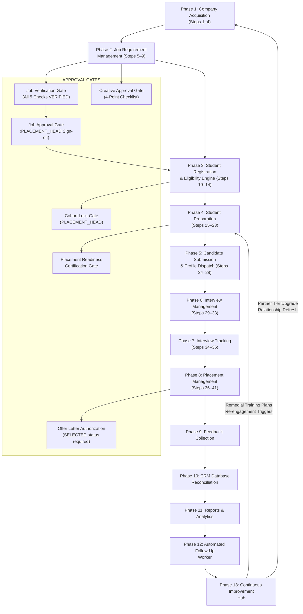
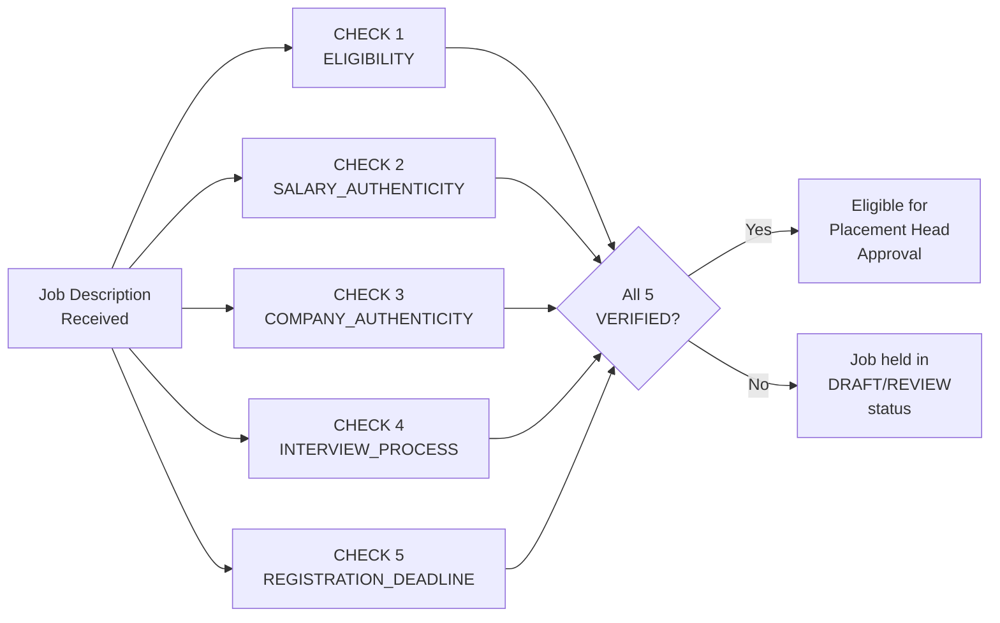
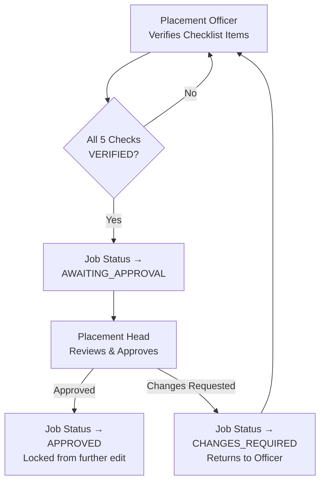
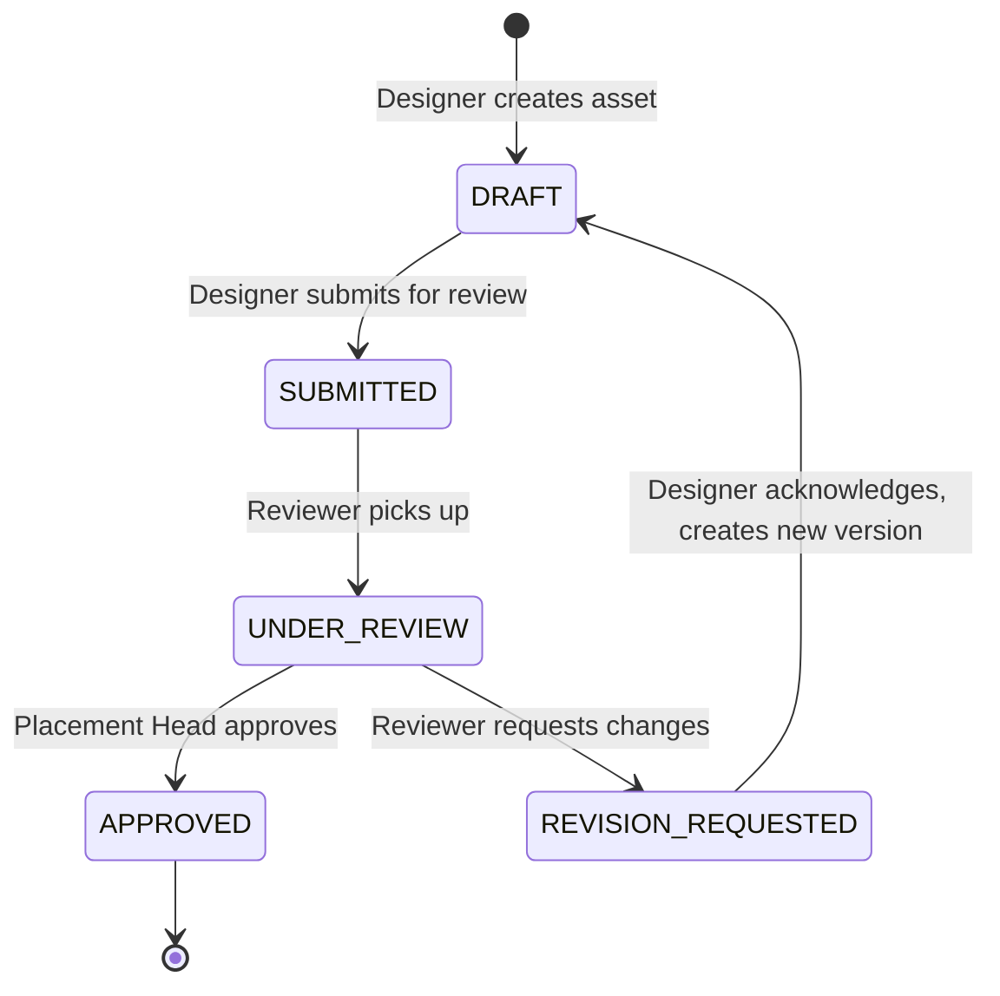
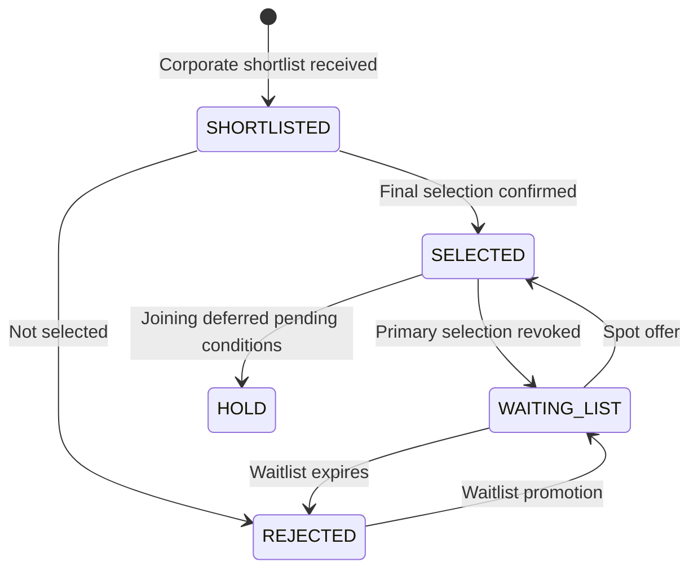
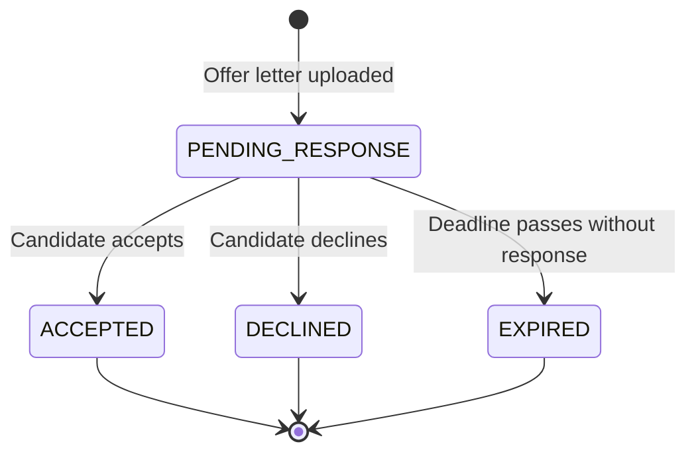

# 04 — Workflow and Business Rules

> **Status:** Phase 0 Documentation — Not Approved for Implementation
> **Prepared:** 2026-11-03
> **Document Owner:** GQT Platform Architecture Team
> **Scope:** GQT HRMS & Recruitment CRM Platform — 13-Phase, 41-Step Institutional Recruitment Workflow

---

## Legend

| Tag | Meaning |
|-----|---------|
| ✅ **CONFIRMED RULE** | Explicitly stated in `HRMS_REQUIREMENTS_AUDIT.md` or the source workflow PDF |
| 🔵 **PROPOSED RULE** | Architectural best practice not yet explicitly confirmed in requirements |
| ❓ **UNRESOLVED DECISION** | Requires explicit GQT decision before implementation |

---

## Section 1: End-to-End Lifecycle Overview

The complete recruitment lifecycle spans 13 phases and 41 operational steps, from initial company outreach through continuous improvement. The diagram below represents the canonical flow.

### Phase Summary Table

| Phase | Steps | Key Output | Critical Gate |
|-------|-------|-----------|---------------|
| 1 — Company Acquisition | 1–4 | Qualified HR Contact + FollowUp chain | Duplicate domain detection |
| 2 — Job Requirement Management | 5–9 | Approved Job + Approved Creative | 5-check verification + PLACEMENT_HEAD approval |
| 3 — Student Registration & Eligibility | 10–14 | Locked Candidate Cohort | Eligibility engine + Cohort lock |
| 4 — Student Preparation | 15–23 | Placement Readiness Certification | Certification gate (Step 23) |
| 5 — Candidate Submission & Dispatch | 24–28 | Dispatch log + Company acknowledgement | Package integrity (SHA-256) |
| 6 — Interview Management | 29–33 | Confirmed attendance + Reminders sent | Idempotent reminder delivery |
| 7 — Interview Tracking | 34–35 | Round results + Corporate follow-up | Staff notes isolation |
| 8 — Placement Management | 36–41 | Joining audit record | Offer letter upload authorization |
| 9 — Feedback Collection | — | 360° feedback records | Anonymity masking |
| 10 — CRM Reconciliation | — | Verified partner promotions | 8-domain reconciliation |
| 11 — Reports & Analytics | — | Sanitized CSV/PDF exports | Formula injection prevention |
| 12 — Automated Follow-Up | — | Escalation queue | Overdue detection |
| 13 — Continuous Improvement | — | Skill gap matrix + Remedial plans | Placement rate baseline |

---

## Section 2: Five Mandatory Job Verification Checks

> ✅ **CONFIRMED RULE:** All five checks must reach `VERIFIED` status before a job can be approved. An approval attempt with any check in non-`VERIFIED` state must be rejected with HTTP 400. *(Source: Phase 2, Step 6–7)*

---

### Check 1: ELIGIBILITY

| Attribute | Detail |
|-----------|--------|
| **What it verifies** | The job's stated candidate eligibility criteria are institutionally compliant: branch matching is valid, minimum CGPA/percentage threshold is within GQT norms, graduation year window is current, and active backlog policy is specified |
| **Why it matters** | Prevents publishing jobs that no enrolled student can qualify for, or jobs with criteria that contradict institutional academic policies |
| **Who performs** | `PLACEMENT_OFFICER` or `PLACEMENT_HEAD` or `ADMIN` (`CanVerifyJobChecklist` permission) |
| **Evidence required** | Verification note field (text) documenting that criteria were reviewed and match institutional norms |
| **On PASS** | Check status → `VERIFIED`; check-item stamped with verifier user ID and timestamp |
| **On FAIL** | Check status → `FAILED` or remains `PENDING`; job cannot proceed to approval; officer must log a reason |

**Unresolved Questions:**
- ❓ Is there a minimum CGPA floor GQT considers too low to publish (e.g., no jobs below 5.0 CGPA)? Needs GQT academic policy input.
- ❓ Can a job have "any branch" as valid eligibility, or must at least one branch be specified?

---

### Check 2: SALARY_AUTHENTICITY

| Attribute | Detail |
|-----------|--------|
| **What it verifies** | The stated CTC range (min and max) is plausible and consistent with market rates for the role, company size, and location; not inflated to attract candidates under false pretences |
| **Why it matters** | Protects institutional reputation; prevents companies from posting misleading compensation to harvest candidate profiles |
| **Who performs** | `PLACEMENT_OFFICER`, `PLACEMENT_HEAD`, or `ADMIN` |
| **Evidence required** | Verifier note documenting the source cross-reference (e.g., company's published offer letter, offer from prior batch, LinkedIn salary range, Glassdoor). Link or document reference preferred |
| **On PASS** | Check status → `VERIFIED` |
| **On FAIL** | Job held; officer must document discrepancy; company may be contacted for clarification |

**Unresolved Questions:**
- ❓ Is there a mandatory minimum salary threshold (e.g., GQT will not post jobs below ₹X LPA) — needs institutional policy definition.
- ❓ Should CTC max/min be stored as structured fields or as free text in the JD? (Structured fields enable automated plausibility checking.)
- ❓ Who arbitrates a disputed salary claim — PLACEMENT_HEAD only, or can PLACEMENT_OFFICER escalate independently?

---

### Check 3: COMPANY_AUTHENTICITY

| Attribute | Detail |
|-----------|--------|
| **What it verifies** | The company is a legitimately registered entity: GST/CIN registration exists, website domain is live and matches the company name, and the HR contact's corporate email domain matches the company |
| **Why it matters** | Guards against fraudulent companies using placement drives to harvest student personal data or conduct fake interviews |
| **Who performs** | `PLACEMENT_OFFICER`, `PLACEMENT_HEAD`, or `ADMIN` |
| **Evidence required** | CIN/GST number, working website URL, and corporate email domain match. Supporting document or screenshot may be attached |
| **On PASS** | Check status → `VERIFIED`; company record flagged as verified |
| **On FAIL** | Job is blocked; company record must be reviewed; may trigger company record audit |

**Unresolved Questions:**
- ❓ Should company verification be a one-time process (verify the `Company` record, not re-verified per job) or per-job?
- ❓ Is a GST/CIN number a mandatory field, or is it sufficient for the officer to attest verbally via a note?

---

### Check 4: INTERVIEW_PROCESS

| Attribute | Detail |
|-----------|--------|
| **What it verifies** | The stated interview rounds are clearly defined (round types, sequence, and approximate duration); evaluation criteria per round are disclosed; no undisclosed processing fee exists |
| **Why it matters** | Prevents surprise round additions mid-process; protects candidates from fraudulent fee-charging interviews |
| **Who performs** | `PLACEMENT_OFFICER`, `PLACEMENT_HEAD`, or `ADMIN` |
| **Evidence required** | Verifier note confirming round types reviewed; JD field `interview_stages` populated; explicit confirmation that no fee is charged at any stage |
| **On PASS** | Check status → `VERIFIED` |
| **On FAIL** | Job held pending process clarification from company |

**Unresolved Questions:**
- ❓ If a company adds a round after job approval, does `INTERVIEW_PROCESS` check need re-verification?
- ❓ Is there a maximum number of interview rounds GQT will allow (e.g., no more than 6 rounds)?

---

### Check 5: REGISTRATION_DEADLINE

| Attribute | Detail |
|-----------|--------|
| **What it verifies** | The application deadline is a future date with sufficient lead time for student registration (minimum advance notice period to be confirmed); the deadline does not conflict with institutional exam schedules |
| **Why it matters** | Ensures students have adequate time to apply; prevents last-minute registrations that undermine preparation |
| **Who performs** | `PLACEMENT_OFFICER`, `PLACEMENT_HEAD`, or `ADMIN` |
| **Evidence required** | Verifier note confirming deadline is future-dated and provides minimum notice; any academic calendar conflict checked |
| **On PASS** | Check status → `VERIFIED`; deadline stored and triggers automated reminders |
| **On FAIL** | Job held; company asked to extend deadline or job deferred |

**Unresolved Questions:**
- ❓ What is the minimum lead time GQT requires between job publication and application deadline? (e.g., 72 hours? 5 business days?)
- ❓ Should the system auto-fail this check if `application_deadline` is within 24 hours of check timestamp?

---

## Section 3: Approval Gate Rules

### 3.1 Job Verification vs Job Approval

| Rule | Status |
|------|--------|
| A `PLACEMENT_OFFICER` may verify checklist items but **cannot** approve the job | ✅ CONFIRMED |
| `PLACEMENT_HEAD` or `ADMIN` can approve jobs | ✅ CONFIRMED |
| All 5 checks must be `VERIFIED` before approval action is available | ✅ CONFIRMED |
| The same person who verified the checklist **can** be the approver if they hold `PLACEMENT_HEAD` role | ❓ UNRESOLVED — GQT must decide if self-approval (verify + approve by same person) is permitted |
| Approval locks the job description against further modification | ✅ CONFIRMED |

---

### 3.2 Re-Approval After Approval

| Rule | Status |
|------|--------|
| Any modification to an approved job must trigger mandatory re-approval | 🔵 PROPOSED — architectural best practice to preserve audit trail integrity |
| Re-approval must re-run all 5 checklist items for verification (or carry forward existing verified items) | ❓ UNRESOLVED — does a minor edit (e.g., fixing a typo in the job title) require full re-verification? |
| Version history of job modifications must be preserved in an audit log | 🔵 PROPOSED |

---

### 3.3 Creative Design Review vs Final Creative Approval

| Gate | Role | Status |
|------|------|--------|
| Creative upload | `CREATIVE_DESIGNER` | ✅ CONFIRMED |
| 4-point checklist review (Flyer text, Logo, QR code, Link/contacts) | `CREATIVE_REVIEWER` or `PLACEMENT_HEAD` | ✅ CONFIRMED |
| Final creative approval (sign-off to publish) | `PLACEMENT_HEAD` or `ADMIN` only | ✅ CONFIRMED |
| Can a `CREATIVE_REVIEWER` approve without `PLACEMENT_HEAD` sign-off? | — | ❓ UNRESOLVED |

---

### 3.4 Candidate Cohort Lock and Override Authorization

| Rule | Status |
|------|--------|
| `PLACEMENT_HEAD` or `ADMIN` can lock a candidate cohort | ✅ CONFIRMED |
| A locked cohort cannot be mutated (no additions, no removals) without authorized override | ✅ CONFIRMED |
| Manual override of a locked cohort requires an explicit reason (mandatory text field) | ✅ CONFIRMED |
| Who can authorize a post-lock override? | ❓ UNRESOLVED — PLACEMENT_HEAD only, or can ADMIN override without PLACEMENT_HEAD concurrence? |

---

### 3.5 Placement Readiness Certification Gate

| Rule | Status |
|------|--------|
| Certification is issued by `PLACEMENT_HEAD` (Step 23) | ✅ CONFIRMED |
| No candidate may be submitted to a company without an active `PlacementReadinessCertification` where `is_approved_for_placements == True` | ✅ CONFIRMED |
| Certification must be per-candidate, per-submission package | 🔵 PROPOSED |
| Certification expiry: does a certification expire? | ❓ UNRESOLVED |

---

### 3.6 Offer Letter Authorization

| Rule | Status |
|------|--------|
| Offer letter can only be uploaded for candidates with status `SELECTED` | ✅ CONFIRMED |
| Upload is restricted to `PLACEMENT_HEAD` or `ADMIN` | ✅ CONFIRMED |
| Offer letter must pass `%PDF-` magic bytes validation | ✅ CONFIRMED |
| Offer letter served via authenticated streaming endpoint (no public URL) | ✅ CONFIRMED |

---

## Section 4: Student Eligibility Rules

### 4.1 Academic Criteria

| Criterion | Rule | Status |
|-----------|------|--------|
| **Branch matching** | Student's enrolled branch must match at least one of the job's specified eligible branches | ✅ CONFIRMED |
| **Minimum CGPA** | Student CGPA must be ≥ job's `min_cgpa` field | ✅ CONFIRMED |
| **Graduation year** | Student's `graduation_year` must match job's `eligible_batches` | ✅ CONFIRMED |
| **Active backlog cutoff** | Presence of active backlogs is evaluated against job's backlog policy (zero-tolerance or threshold) | ✅ CONFIRMED |
| **Attendance percentage** | Whether minimum attendance is an eligibility criterion | ❓ UNRESOLVED |
| **Course opted** | Whether `course_opted` (from Student Portal profile) affects eligibility | ❓ UNRESOLVED |

---

### 4.2 Registration Requirements

| Requirement | Status |
|-------------|--------|
| Institutional email uniqueness (one account per institutional email) | ✅ CONFIRMED |
| Roll number uniqueness within institution | ✅ CONFIRMED |
| Resume upload required before eligibility evaluation | 🔵 PROPOSED |
| What supporting academic documents (transcripts, marksheets) are mandatory? | ❓ UNRESOLVED |

---

### 4.3 Manual Override

| Rule | Status |
|------|--------|
| Manual override of ineligibility is permitted | ✅ CONFIRMED |
| Override requires a mandatory reason (text field, cannot be blank) | ✅ CONFIRMED |
| Override creates an immutable audit trail entry | 🔵 PROPOSED (inferred from audit architecture) |
| Who can perform an override? | ❓ UNRESOLVED — `PLACEMENT_HEAD` only, or also `ADMIN`? Can `PLACEMENT_OFFICER` override? |
| Can an override be reversed? | ❓ UNRESOLVED |

---

### 4.4 Eligibility Status Values

| Status | Meaning | Status |
|--------|---------|--------|
| `ELIGIBLE` | All academic criteria met automatically | ✅ CONFIRMED |
| `INELIGIBLE` | One or more criteria not met | ✅ CONFIRMED |
| `MANUALLY_APPROVED` | Ineligible by rule but overridden by authorized staff | ✅ CONFIRMED |
| `PENDING` | Evaluation not yet run, or awaiting profile completion | 🔵 PROPOSED |

---

## Section 5: Creative Versioning Rules

### 5.1 Version Lifecycle

| Rule | Status |
|------|--------|
| Version numbers are monotonically incrementing integers (v1, v2, v3…) | ✅ CONFIRMED (inferred from `CreativeAssetVersion` model) |
| Only the most recent version can be submitted for review | 🔵 PROPOSED |
| Approved versions are immutable — no further edits allowed to that version | 🔵 PROPOSED |
| A new revision creates a new version record; prior versions are preserved | 🔵 PROPOSED |

---

### 5.2 Four-Point Design Checklist

> ✅ **CONFIRMED RULE:** Reviewer must verify all four points before recommending approval. *(Source: Phase 2, Step 9)*

| Point | What Is Verified |
|-------|-----------------|
| **1. Flyer Text** | Job title, company name, role description, and date/time are accurate and match the approved job record |
| **2. Logo** | Company logo is current, correctly branded, and not distorted; GQT institutional logo is present if required |
| **3. QR Code** | QR code scans successfully and links to the correct, live registration/job URL |
| **4. Link/Contacts** | All printed contact details (email, phone, WhatsApp number) are correct and reachable |

---

### 5.3 Maximum Revision Cycles Before Escalation

| Rule | Status |
|------|--------|
| Maximum number of revision cycles before automatic escalation to `PLACEMENT_HEAD` | ❓ UNRESOLVED — Needs GQT decision (recommendation: 3 revision cycles) |
| Escalation notification mechanism when threshold reached | 🔵 PROPOSED |

---

### 5.4 Approval Rights

| Action | Who | Status |
|--------|-----|--------|
| Upload creative asset | `CREATIVE_DESIGNER`, `PLACEMENT_HEAD`, `ADMIN` | ✅ CONFIRMED |
| Review and verify 4-point checklist | `CREATIVE_REVIEWER`, `PLACEMENT_HEAD`, `ADMIN` | ✅ CONFIRMED |
| Final approval (status → APPROVED) | `PLACEMENT_HEAD`, `ADMIN` | ✅ CONFIRMED |
| Can reviewer = approver? | — | ❓ UNRESOLVED |

---

## Section 6: Resume and Document Rules

### 6.1 Resume Storage

| Rule | Status |
|------|--------|
| Resumes are stored in private, isolated storage — never served via public URLs | ✅ CONFIRMED |
| Access is via authenticated streaming `FileResponse` endpoint only | ✅ CONFIRMED |
| Storage backend must be configured as a non-publicly accessible bucket or filesystem path | ✅ CONFIRMED |

---

### 6.2 File Validation Rules

| Validation | Detail | Status |
|------------|--------|--------|
| **Magic bytes** | File must begin with `%PDF-` bytes; any other signature is rejected | ✅ CONFIRMED |
| **Size limit** | Maximum 5 MB per resume file | ✅ CONFIRMED |
| **Hash** | SHA-256 digest computed on upload and stored; verified on serve | ✅ CONFIRMED |
| **SVG rejection** | SVG files explicitly rejected (XSS vector) | ✅ CONFIRMED |
| **MIME type** | Only `application/pdf` accepted | 🔵 PROPOSED (implied by magic bytes check) |

---

### 6.3 Version Numbering

| Rule | Status |
|------|--------|
| Resume versions are monotonically incrementing (v1, v2, v3…) | ✅ CONFIRMED |
| No version numbers may be reused or skipped | 🔵 PROPOSED |
| Each version stored as a separate file record with its own SHA-256 | 🔵 PROPOSED |
| The "active" resume for submission is the latest approved version | 🔵 PROPOSED |

---

### 6.4 Cross-Candidate Isolation

| Rule | Status |
|------|--------|
| Student A cannot access Student B's resume under any circumstance | ✅ CONFIRMED — enforced by `IsStudentOwnerOrStaff` |
| Cross-student download attempts must be rejected with `403 Forbidden` | ✅ CONFIRMED |
| Staff (Placement Officers, Trainers, Placement Head) may access any student resume | ✅ CONFIRMED |
| Whether `TRAINER` role can access student resumes | ❓ UNRESOLVED |

---

### 6.5 Resume Submission Authorization

| Rule | Status |
|------|--------|
| Only authorized staff may submit a candidate's resume to a company | ✅ CONFIRMED |
| `PLACEMENT_HEAD`, `PLACEMENT_OFFICER`, `ADMIN` may dispatch resume packages | ✅ CONFIRMED |
| Students cannot self-submit directly to companies via the HRMS | 🔵 PROPOSED |

---

## Section 7: Duplicate Detection Rules

### 7.1 Company Duplicates

| Rule | Status |
|------|--------|
| Duplicate detection is based on normalized root domain collision | ✅ CONFIRMED |
| Domain normalization strips protocol (`https://`), `www.`, trailing slashes, and lowercase-normalizes | 🔵 PROPOSED (implementation detail) |
| A new company entry with an already-registered domain must be flagged and require staff confirmation | ✅ CONFIRMED |
| Whether exact company name collision (without domain) also triggers a duplicate warning | ❓ UNRESOLVED |

---

### 7.2 HR Contact Duplicates

| Rule | Status |
|------|--------|
| Email uniqueness across HR contacts is enforced at the database level | ✅ CONFIRMED |
| Phone number uniqueness is enforced | ✅ CONFIRMED |
| Combined email + phone must be unique | 🔵 PROPOSED |
| A duplicate HR contact creation attempt must return a clear error identifying the existing record | 🔵 PROPOSED |

---

### 7.3 Student Duplicates

| Rule | Status |
|------|--------|
| Institutional email must be unique across all student records | ✅ CONFIRMED |
| Roll number must be unique within an institution/college | ✅ CONFIRMED |
| Combination of institutional email + roll number uniqueness | 🔵 PROPOSED |

---

### 7.4 Candidate Submission Duplicates

| Rule | Status |
|------|--------|
| Atomic uniqueness constraint: one submission per student per job/drive | ✅ CONFIRMED |
| Enforced at the database level (unique constraint, not application logic alone) | ✅ CONFIRMED |
| Concurrent submission attempts handled by `select_for_update` and atomic constraint | ✅ CONFIRMED |
| Error message on duplicate submission must be user-friendly (not expose internal constraint name) | 🔵 PROPOSED |

---

## Section 8: Interview Round Rules

### 8.1 Round Types

> ✅ **CONFIRMED RULE:** Five round types are supported. *(Source: Phase 6–7, Step 34)*

| Round Type | Description |
|-----------|-------------|
| `APTITUDE` | Quantitative, logical, verbal ability assessment |
| `CODING` | Live or take-home programming challenge |
| `TECHNICAL` | Domain knowledge and technical skills interview |
| `HR` | Behavioral, cultural fit, compensation discussion |
| `MANAGERIAL` | Senior-level panel, leadership assessment |

---

### 8.2 Round Transition Rules

| Rule | Status |
|------|--------|
| Can rounds be added after the interview process has started? | ❓ UNRESOLVED — should trigger re-verification of `INTERVIEW_PROCESS` check |
| Can a round's result be changed after it has been recorded? | ❓ UNRESOLVED — 🔵 PROPOSED: No — corrections require a new audit entry, not in-place edit |
| Round sequence must be defined before interview invitations are sent | 🔵 PROPOSED |

---

### 8.3 Attendance Tracking

| Status | Meaning | Status |
|--------|---------|--------|
| `CONFIRMED` | Candidate confirmed attendance | ✅ CONFIRMED |
| `DECLINED` | Candidate explicitly declined | ✅ CONFIRMED |
| `TENTATIVE` | Candidate has not confirmed | ✅ CONFIRMED |

---

### 8.4 Outcome Tracking

| Outcome | Meaning | Status |
|---------|---------|--------|
| `CONDUCTED` | Interview round took place as scheduled | ✅ CONFIRMED |
| `CANDIDATE_ABSENT` | Candidate did not appear | ✅ CONFIRMED |
| `RESCHEDULED` | Round deferred to a new date/time | ✅ CONFIRMED |

---

### 8.5 Staff Notes Isolation

| Rule | Status |
|------|--------|
| Staff notes/evaluator comments recorded per round | ✅ CONFIRMED |
| Staff notes must be stripped from all candidate-facing API serializers | ✅ CONFIRMED |
| Staff notes are visible to `PLACEMENT_OFFICER`, `PLACEMENT_HEAD`, `ADMIN`, `TRAINER` | 🔵 PROPOSED |
| Failure to strip staff notes is a security defect | ✅ CONFIRMED |

---

## Section 9: Selection → Offer → Joining Lifecycle

### 9.1 Candidate Status Progression

| Status | Meaning | Status |
|--------|---------|--------|
| `SELECTED` | Candidate received an offer | ✅ CONFIRMED |
| `REJECTED` | Candidate not selected | ✅ CONFIRMED |
| `WAITING_LIST` | On reserve; may convert | ✅ CONFIRMED |
| `HOLD` | Selection conditional or pending | ✅ CONFIRMED |

---

### 9.2 Offer Lifecycle

| Status | Trigger | Status |
|--------|---------|--------|
| `PENDING_RESPONSE` | Offer letter uploaded by staff | ✅ CONFIRMED |
| `ACCEPTED` | Student accepts via portal self-service | ✅ CONFIRMED |
| `DECLINED` | Student declines | ✅ CONFIRMED |
| `EXPIRED` | Deadline passes without response | ✅ CONFIRMED |

---

### 9.3 Joining Audit

| Status | Meaning | Status |
|--------|---------|--------|
| `JOINED` | Candidate reported to joining location on designated date | ✅ CONFIRMED |
| `NOT_JOINED` | Candidate did not join after accepting offer | ✅ CONFIRMED |
| `DEFERRED` | Joining postponed by mutual agreement | ✅ CONFIRMED |

---

### 9.4 Deferred Joining Rules

| Rule | Status |
|------|--------|
| Deferred joining requires explicit documentation of deferral reason | 🔵 PROPOSED |
| Who approves a deferral request? | ❓ UNRESOLVED — PLACEMENT_HEAD only? ADMIN also? Can PLACEMENT_OFFICER record a deferral? |
| Is there a maximum deferral duration? | ❓ UNRESOLVED |
| Does deferred status count as "placed" for KPI reporting purposes? | ❓ UNRESOLVED |

---

## Section 10: Notification and Reminder Rules

### 10.1 Automated Reminder Timing

> ✅ **CONFIRMED RULE:** Three automated reminder intervals are defined. *(Source: Phase 6, Step 31)*

| Reminder | Trigger Offset | Channel |
|----------|---------------|---------|
| First reminder | 24 hours before interview | Email + WhatsApp |
| Second reminder | 2 hours before interview | Email + WhatsApp |
| Third reminder | 30 minutes before interview | WhatsApp (time-sensitive) |

---

### 10.2 Idempotency

| Rule | Status |
|------|--------|
| `select_for_update(skip_locked=True)` used to prevent duplicate sends under concurrent workers | ✅ CONFIRMED |
| Each notification has a unique idempotency key (e.g., `{student_id}:{interview_id}:{reminder_type}`) | 🔵 PROPOSED |
| Duplicate delivery is treated as a bug, not a warning | ✅ CONFIRMED |

---

### 10.3 Escalation Rules

| Rule | Status |
|------|--------|
| Overdue follow-ups automatically escalated by Phase 12 worker | ✅ CONFIRMED |
| Escalation threshold (e.g., follow-up overdue by >24 hours) | ❓ UNRESOLVED |
| Escalation destination: PLACEMENT_HEAD? Supervisor? | ❓ UNRESOLVED |

---

### 10.4 Communication Channels

| Channel | Use | Provider | Status |
|---------|-----|----------|--------|
| Email | All notifications | SMTP (production); Simulated (dev/test) | ✅ CONFIRMED |
| WhatsApp | Time-sensitive notifications | Meta Cloud API (production); Simulated (dev/test) | ✅ CONFIRMED |
| Portal noticeboard | Job publications, announcements | Internal HRMS notification model | ✅ CONFIRMED |
| SMS | — | Not specified | ❓ UNRESOLVED |

---

### 10.5 Delivery Status Tracking

| Rule | Status |
|------|--------|
| Delivery status tracked per notification (`SIMULATED`, `DELIVERED`, `FAILED`) | ✅ CONFIRMED |
| WhatsApp delivery callbacks via webhook (`/api/v1/crm/webhooks/whatsapp/`) | ✅ CONFIRMED |
| Webhook signature verified via HMAC-SHA256 (`X-Hub-Signature-256`) | ✅ CONFIRMED |
| Candidate acknowledgement tracking (read receipt) | ❓ UNRESOLVED |

---

## Section 11: Audit Log Rules

### 11.1 Minimum Required Audit Events

> 🔵 **PROPOSED RULE:** The following event categories must generate an immutable audit log entry.

| Event Category | Examples |
|---------------|---------|
| Authentication | Login, logout, failed login, token refresh |
| Job lifecycle | Created, checklist item verified, approved, modified after approval |
| Cohort management | Created, student added, student removed, locked, override applied |
| Creative lifecycle | Uploaded, submitted for review, approved, revision requested |
| Resume operations | Uploaded, downloaded, submitted to company |
| Offer letter | Uploaded, downloaded, status change |
| Approval actions | Any action by `PLACEMENT_HEAD` or `ADMIN` |
| Eligibility overrides | Override applied with reason and actor |
| Sensitive data access | Audit log access, report export |
| User management | Account created, role assigned, password reset |

---

### 11.2 Retention Period

| Rule | Status |
|------|--------|
| Audit log retention period | ❓ UNRESOLVED — Needs GQT decision (legal/compliance requirement). Recommendation: minimum 3 years |
| Are audit logs archived to cold storage after a rolling period? | ❓ UNRESOLVED |

---

### 11.3 Audit Record Correction Policy

| Rule | Status |
|------|--------|
| Audit records must be append-only — no in-place corrections | 🔵 PROPOSED |
| If an audit record contains an error, a correction entry is appended referencing the original record | 🔵 PROPOSED |
| Only `ADMIN` can append correction entries | 🔵 PROPOSED |
| Who can view audit records? | ❓ UNRESOLVED — ADMIN only? AUDITOR role? PLACEMENT_HEAD? |

---

### 11.4 Sensitive Data Redaction

| Rule | Status |
|------|--------|
| Passwords, JWT tokens, and API keys must never appear in audit logs | ✅ CONFIRMED — `apps.core.logging.SensitiveDataFilter` applied |
| Student PII (full name, email, phone) may appear in audit logs but must be handled under data retention policy | ❓ UNRESOLVED |
| Resume file contents must never be logged | 🔵 PROPOSED |
| Salary figures in audit logs — are they redacted or retained? | ❓ UNRESOLVED |

---

## Section 12: KPI and Report Inclusion Rules

### 12.1 Placement Rate Denominator

| Question | Status |
|----------|--------|
| Does placement rate include ALL registered students? | ❓ UNRESOLVED |
| Does placement rate include only students who were declared ELIGIBLE for at least one job? | ❓ UNRESOLVED |
| Does placement rate include only students who were submitted to at least one company? | ❓ UNRESOLVED |
| Does placement rate include DEFERRED joiners? | ❓ UNRESOLVED |
| **Recommendation** | 🔵 PROPOSED: Define three metrics — Registration Rate, Eligible Rate, Placed Rate — to avoid ambiguity |

---

### 12.2 Time Period Definitions

| Term | Recommended Definition | Status |
|------|----------------------|--------|
| **Monthly report** | Calendar month (1st to last day) | 🔵 PROPOSED |
| **Annual report** | Academic year (e.g., July 1 – June 30) vs calendar year | ❓ UNRESOLVED — needs GQT academic calendar input |
| **Placement cycle** | Per-batch (graduation year cohort) | 🔵 PROPOSED |

---

### 12.3 Formula Injection Prevention

> ✅ **CONFIRMED RULE:** All CSV exports must prepend `'` (single quote escape) to any cell value beginning with `=`, `+`, `-`, `@`, `\t`, or `\r`. *(Source: Security Audit, Section 3)*

| Rule | Status |
|------|--------|
| Formula injection escape applied universally to all CSV exports | ✅ CONFIRMED |
| PDF exports do not require formula injection protection | 🔵 PROPOSED |
| JSON API exports do not require formula injection protection | 🔵 PROPOSED |

---

### 12.4 Export Scope and Authorization

| Role | Export Scope | Status |
|------|-------------|--------|
| `ADMIN` | Platform-wide; all colleges, all batches | 🔵 PROPOSED |
| `PLACEMENT_HEAD` | College-scoped; all batches within their institution | 🔵 PROPOSED |
| `AUDITOR` (Reporting role) | Read-only; same scope as PLACEMENT_HEAD | 🔵 PROPOSED |
| `PLACEMENT_OFFICER` | Can they export? If yes, own records only? | ❓ UNRESOLVED |
| `STUDENT` | Cannot export reports | 🔵 PROPOSED |

---

*End of Document 04 — Workflow and Business Rules*
