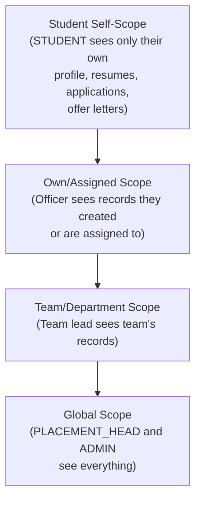
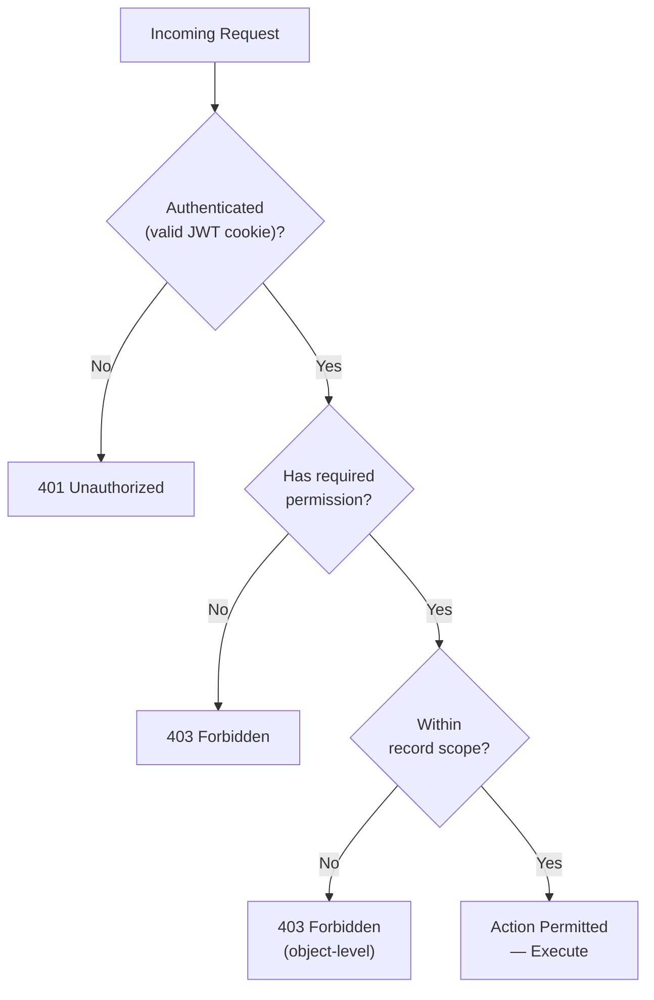

# 05 — Roles and Permissions

> **Status:** Phase 0 Documentation — Not Approved for Implementation
> **Prepared:** 2026-11-03
> **Document Owner:** GQT Platform Architecture Team
> **Scope:** GQT HRMS & Recruitment CRM Platform — Authorization Model

---

## Legend

| Tag | Meaning |
|-----|---------|
| ✅ **CONFIRMED** | Role or permission explicitly confirmed in requirements |
| 🔵 **PROPOSED** | Architectural recommendation not yet explicitly confirmed |
| ❓ **PENDING-GQT-DECISION** | Requires explicit GQT input before implementation |

---

## Section 1: Role Definitions

> **Note:** Role IDs are assigned for traceability purposes in Phase 0 documentation. Final IDs will be confirmed during schema design.

### ROLE-001 — Super Admin

| Field | Value |
|-------|-------|
| **Role ID** | ROLE-001 |
| **Role Name** | Super Administrator |
| **Role Code** | `ADMIN` |
| **Description** | Platform-level administrator with unrestricted access to all modules, records, and operations. Responsible for user account management, role assignment, system configuration, and emergency access. |
| **Business Purpose** | Ensures platform integrity, performs administrative overrides, manages all user accounts. |
| **Who creates/assigns** | System bootstrap (first account); subsequent ADMIN accounts created by existing ADMIN only |
| **Typical user count** | 1–3 |
| **Approval Status** | ✅ CONFIRMED |

---

### ROLE-002 — Placement Head

| Field | Value |
|-------|-------|
| **Role ID** | ROLE-002 |
| **Role Name** | Placement Head |
| **Role Code** | `PLACEMENT_HEAD` |
| **Description** | Senior approver role. The only role that can approve job requirements, creative assets, candidate cohort locks, placement readiness certifications, and offer letter uploads. Global scope over all records. |
| **Business Purpose** | Provides institutional quality gate and final authorization for all placement activities. |
| **Who creates/assigns** | `ADMIN` |
| **Typical user count** | 1–5 |
| **Approval Status** | ✅ CONFIRMED |

---

### ROLE-003 — Placement Officer

| Field | Value |
|-------|-------|
| **Role ID** | ROLE-003 |
| **Role Name** | Placement Officer |
| **Role Code** | `PLACEMENT_OFFICER` |
| **Description** | Operational placement staff. Manages company follow-ups, collects job descriptions, performs 5-point job verification, evaluates student eligibility, and dispatches candidate packages. |
| **Business Purpose** | Day-to-day execution of the recruitment cycle workflow. |
| **Who creates/assigns** | `ADMIN` or `PLACEMENT_HEAD` |
| **Typical user count** | 3–15 |
| **Approval Status** | ✅ CONFIRMED |

---

### ROLE-004 — Company Acquisition / Calling Executive

| Field | Value |
|-------|-------|
| **Role ID** | ROLE-004 |
| **Role Name** | Company Acquisition Executive |
| **Role Code** | `CALLING_EXECUTIVE` |
| **Description** | CRM outreach specialist responsible for identifying target companies, cold-calling and messaging HR contacts, logging outreach activity, and escalating interested leads to Placement Officers. Targeted at 100+ HR touchpoints per day. |
| **Business Purpose** | Drives the top-of-funnel company acquisition pipeline. |
| **Who creates/assigns** | `ADMIN` or `PLACEMENT_HEAD` |
| **Typical user count** | 2–10 |
| **Approval Status** | ✅ CONFIRMED |

---

### ROLE-005 — Recruitment CRM Executive

| Field | Value |
|-------|-------|
| **Role ID** | ROLE-005 |
| **Role Name** | Recruitment CRM Executive |
| **Role Code** | `CRM_EXECUTIVE` |
| **Description** | Manages the CRM pipeline post-lead qualification: tracks HR responses, manages follow-up schedules, records company and contact information, and supports submission package logistics. |
| **Business Purpose** | Maintains data quality and completeness of the CRM database. |
| **Who creates/assigns** | `ADMIN` or `PLACEMENT_HEAD` |
| **Typical user count** | 2–8 |
| **Approval Status** | ✅ CONFIRMED |

---

### ROLE-006 — Creative Designer

| Field | Value |
|-------|-------|
| **Role ID** | ROLE-006 |
| **Role Name** | Creative Designer |
| **Role Code** | `CREATIVE_DESIGNER` |
| **Description** | Designs and uploads promotional creative assets (Flyers, Banners, Social Posts) for approved jobs. Manages creative versions and responds to revision requests. |
| **Business Purpose** | Produces compliant visual materials for student-facing job announcements. |
| **Who creates/assigns** | `ADMIN` or `PLACEMENT_HEAD` |
| **Typical user count** | 1–5 |
| **Approval Status** | ✅ CONFIRMED |

---

### ROLE-007 — Creative Reviewer

| Field | Value |
|-------|-------|
| **Role ID** | ROLE-007 |
| **Role Name** | Creative Reviewer |
| **Role Code** | `CREATIVE_REVIEWER` |
| **Description** | Reviews uploaded creative assets against the 4-point design checklist (Flyer text, Logo, QR code, Link/contacts). Recommends approval or requests revisions. Cannot issue final approval independently. |
| **Business Purpose** | Quality-gates creative assets before Placement Head final sign-off. |
| **Who creates/assigns** | `ADMIN` or `PLACEMENT_HEAD` |
| **Typical user count** | 1–3 |
| **Approval Status** | ✅ CONFIRMED |

---

### ROLE-008 — Trainer / Student Preparation Staff

| Field | Value |
|-------|-------|
| **Role ID** | ROLE-008 |
| **Role Name** | Trainer |
| **Role Code** | `TRAINER` |
| **Description** | Conducts aptitude, technical, communication, and grooming training sessions. Reviews student resumes, scores mock interviews, and submits readiness recommendations. |
| **Business Purpose** | Prepares candidates for corporate recruitment interviews. |
| **Who creates/assigns** | `ADMIN` or `PLACEMENT_HEAD` |
| **Typical user count** | 3–20 |
| **Approval Status** | ✅ CONFIRMED |

---

### ROLE-009 — Interview Coordinator

| Field | Value |
|-------|-------|
| **Role ID** | ROLE-009 |
| **Role Name** | Interview Coordinator |
| **Role Code** | `INTERVIEW_COORDINATOR` |
| **Description** | Coordinates interview logistics: sends invitations, tracks attendance confirmation, records interview outcomes, manages round scheduling, and follows up with corporate HR. |
| **Business Purpose** | Ensures smooth execution of multi-round interview processes. |
| **Who creates/assigns** | `ADMIN` or `PLACEMENT_HEAD` |
| **Typical user count** | 1–5 |
| **Approval Status** | ✅ CONFIRMED |

---

### ROLE-010 — Reporting / Auditor

| Field | Value |
|-------|-------|
| **Role ID** | ROLE-010 |
| **Role Name** | Auditor |
| **Role Code** | `AUDITOR` |
| **Description** | Read-only analytics access. Can view reports, dashboards, KPIs, and audit logs. Cannot create, modify, or approve any records. |
| **Business Purpose** | Enables compliance review, performance monitoring, and institutional reporting without operational access. |
| **Who creates/assigns** | `ADMIN` only |
| **Typical user count** | 1–5 |
| **Approval Status** | ✅ CONFIRMED |

---

### ROLE-011 — Student

| Field | Value |
|-------|-------|
| **Role ID** | ROLE-011 |
| **Role Name** | Student Candidate |
| **Role Code** | `STUDENT` |
| **Description** | Self-service candidate role. Can view their own profile, upload resumes, view job publications, check eligibility, view their own applications, and manage their offer acceptance. Zero privilege escalation possible. |
| **Business Purpose** | Enables candidate self-service without exposing operational data to candidates. |
| **Who creates/assigns** | Self-registration (AllowAny endpoint); role assigned automatically |
| **Typical user count** | Hundreds to thousands |
| **Approval Status** | ✅ CONFIRMED — ❓ PENDING-GQT-DECISION on whether self-service portal is required for first release |

---

## Section 2: Permissions Matrix

### 2.1 Module-Level Permissions Matrix

> **Cell Key:**  
> `—` = No access (deny by default)  
> `R` = Read  
> `C` = Create  
> `U` = Update  
> `A` = Approve  
> `P` = Publish  
> `E` = Export  
> `ADM` = Full Admin

| Module | ADMIN | PLACEMENT_HEAD | PLACEMENT_OFFICER | CALLING_EXECUTIVE | CRM_EXECUTIVE | CREATIVE_DESIGNER | CREATIVE_REVIEWER | TRAINER | INTERVIEW_COORDINATOR | AUDITOR | STUDENT |
|--------|-------|----------------|-------------------|-------------------|---------------|-------------------|-------------------|---------|----------------------|---------|---------|
| **MOD-001 Company CRM** | ADM | R,C,U,A,E | R,C,U | R,C | R,C,U | — | — | — | — | R,E | — |
| **MOD-002 HR Contacts** | ADM | R,C,U,E | R,C,U | R,C | R,C,U | — | — | — | — | R,E | — |
| **MOD-003 Outreach Logs** | ADM | R,C,U,E | R,C,U | R,C | R,C,U | — | — | — | — | R,E | — |
| **MOD-004 Follow-Ups** | ADM | R,C,U,E | R,C,U | R,C | R,C,U | — | — | — | — | R,E | — |
| **MOD-005 Job Requirements** | ADM | R,C,U,A,E | R,C,U | — | R | — | — | R | R | R,E | R |
| **MOD-006 Job Checklist** | ADM | R,C,U,A | R,C,U | — | — | — | — | — | — | R | — |
| **MOD-007 Creative Assets** | ADM | R,C,U,A,P | R | — | — | R,C,U | R | — | — | R | — |
| **MOD-008 Student Profiles** | ADM | R,U,E | R,U | — | — | — | — | R,U | R | R,E | R (own) |
| **MOD-009 Eligibility Engine** | ADM | R,U,A,E | R,U | — | — | — | — | R | R | R,E | R (own) |
| **MOD-010 Candidate Cohorts** | ADM | R,C,U,A | R,C,U | — | — | — | — | R | R | R,E | — |
| **MOD-011 Student Preparation** | ADM | R,C,U,A | R | — | — | — | — | R,C,U | R | R,E | R (own) |
| **MOD-012 Submissions** | ADM | R,C,U,A,P | R,C,U | — | — | — | — | — | R | R,E | R (own) |
| **MOD-013 Interviews** | ADM | R,C,U,A | R,U | — | — | — | — | — | R,C,U | R,E | R (own) |
| **MOD-014 Placements** | ADM | R,C,U,A,P | R,U | — | — | — | — | — | R,U | R,E | R (own) |
| **MOD-015 Offer Letters** | ADM | R,C,U,P | R | — | — | — | — | — | — | R,E | R (own) |
| **MOD-016 Feedback** | ADM | R,E | R | — | — | — | — | R,C | — | R,E | R,C (own) |
| **MOD-017 CRM Reconciliation** | ADM | R,C,U,A | R,U | — | R | — | — | — | — | R,E | — |
| **MOD-018 Reports & Analytics** | ADM | R,E | R | — | — | — | — | R | R | R,E | — |
| **MOD-019 Audit Logs** | ADM | — | — | — | — | — | — | — | — | R | — |
| **MOD-020 User Management** | ADM | — | — | — | — | — | — | — | — | — | — |

> ❓ **UNRESOLVED:** Several cells in this matrix require GQT confirmation — particularly TRAINER access to student academic records (MOD-008, MOD-009), INTERVIEW_COORDINATOR access to salary data within MOD-005, and PLACEMENT_OFFICER export rights in MOD-018.

---

### 2.2 Sensitive Action Authorization Sub-Tables

#### Approve Job

| Action | Permitted Roles | Conditions | Status |
|--------|----------------|-----------|--------|
| `approve_job_requirement` | `PLACEMENT_HEAD`, `ADMIN` | All 5 checklist items must be `VERIFIED` | ✅ CONFIRMED |
| Rejection with required changes | `PLACEMENT_HEAD`, `ADMIN` | Reason text field mandatory | 🔵 PROPOSED |

#### Approve Creative Asset

| Action | Permitted Roles | Conditions | Status |
|--------|----------------|-----------|--------|
| `approve_creative_version` | `PLACEMENT_HEAD`, `ADMIN` | 4-point checklist must be reviewed | ✅ CONFIRMED |
| Request revision | `CREATIVE_REVIEWER`, `PLACEMENT_HEAD`, `ADMIN` | Revision notes mandatory | ✅ CONFIRMED |

#### Lock Candidate Cohort

| Action | Permitted Roles | Conditions | Status |
|--------|----------------|-----------|--------|
| `finalize_candidate_cohort` (lock) | `PLACEMENT_HEAD`, `ADMIN` | Cohort must be in `FINALIZED` state | ✅ CONFIRMED |
| Post-lock override | `PLACEMENT_HEAD`, `ADMIN` | Mandatory override reason | ✅ CONFIRMED |

#### Certify Placement Readiness

| Action | Permitted Roles | Conditions | Status |
|--------|----------------|-----------|--------|
| `approve_placement_readiness` | `PLACEMENT_HEAD` | Active mock interview score recorded | ✅ CONFIRMED |
| View readiness certification | `PLACEMENT_HEAD`, `ADMIN`, `PLACEMENT_OFFICER`, `TRAINER` | — | 🔵 PROPOSED |

#### Upload Offer Letter

| Action | Permitted Roles | Conditions | Status |
|--------|----------------|-----------|--------|
| Upload offer letter PDF | `PLACEMENT_HEAD`, `ADMIN` | Candidate status must be `SELECTED` | ✅ CONFIRMED |
| Download offer letter | `PLACEMENT_HEAD`, `ADMIN`, `PLACEMENT_OFFICER`, STUDENT (own only) | Authenticated streaming only | ✅ CONFIRMED |

#### Verify Joining Status

| Action | Permitted Roles | Conditions | Status |
|--------|----------------|-----------|--------|
| Record joining outcome (`JOINED`, `NOT_JOINED`, `DEFERRED`) | `PLACEMENT_OFFICER`, `PLACEMENT_HEAD`, `ADMIN` | Candidate must have `ACCEPTED` offer | ✅ CONFIRMED |
| `INTERVIEW_COORDINATOR` joining verification | `INTERVIEW_COORDINATOR` | ❓ UNRESOLVED — scope unclear |  |

#### Export CSV/PDF Reports

| Action | Permitted Roles | Scope | Status |
|--------|----------------|-------|--------|
| Export platform-wide reports | `ADMIN` | All colleges, all batches | 🔵 PROPOSED |
| Export college-scoped reports | `PLACEMENT_HEAD` | Own institution | 🔵 PROPOSED |
| Export read-only reports | `AUDITOR` | Same as PLACEMENT_HEAD scope | 🔵 PROPOSED |
| Export own-record reports | `PLACEMENT_OFFICER` | ❓ UNRESOLVED scope | ❓ UNRESOLVED |

#### Access Audit Logs

| Action | Permitted Roles | Conditions | Status |
|--------|----------------|-----------|--------|
| Read audit logs | `ADMIN`, `AUDITOR` | Read-only; cannot modify | 🔵 PROPOSED |
| Export audit logs | `ADMIN` only | — | 🔵 PROPOSED |

#### Manage User Accounts

| Action | Permitted Roles | Status |
|--------|----------------|--------|
| Create new user accounts | `ADMIN` only | ✅ CONFIRMED |
| Assign / revoke roles | `ADMIN` only | ✅ CONFIRMED |
| Deactivate accounts | `ADMIN` only | 🔵 PROPOSED |

#### Reset Passwords

| Action | Permitted Roles | Status |
|--------|----------------|--------|
| Admin-initiated password reset | `ADMIN` only | 🔵 PROPOSED |
| Self-service password reset | All authenticated users | 🔵 PROPOSED |

---

## Section 3: Record Ownership and Scope Rules

### 3.1 Four Scope Levels

| Scope Level | Roles | Description | Status |
|-------------|-------|-------------|--------|
| **Own/Assigned** | `PLACEMENT_OFFICER`, `CALLING_EXECUTIVE`, `CRM_EXECUTIVE` | Can read and update only records they created or that are assigned to them by a supervisor | 🔵 PROPOSED |
| **Team/Department** | `PLACEMENT_HEAD` (as team lead) | Can see all records owned by their team members | 🔵 PROPOSED |
| **Global** | `PLACEMENT_HEAD`, `ADMIN` | No filter restrictions; can see, update, and approve all records platform-wide | ✅ CONFIRMED |
| **Student Self-Scope** | `STUDENT` | Strictly limited to own profile, own uploaded resumes, own applications, own offer letters | ✅ CONFIRMED |

---

### 3.2 Scope Enforcement Mechanism

| Rule | Status |
|------|--------|
| Scope filters applied at the queryset/selector layer, not in views | 🔵 PROPOSED |
| `IsStudentOwnerOrStaff` permission class enforced for all student-owned resources | ✅ CONFIRMED |
| Querysets must never rely on frontend filtering alone for scope restriction | 🔵 PROPOSED |

---

## Section 4: Object-Level Authorization Rules

### 4.1 Company Record

| Rule | Status |
|------|--------|
| Company records can be created by `PLACEMENT_OFFICER`, `PLACEMENT_HEAD`, `ADMIN`, `CRM_EXECUTIVE`, `CALLING_EXECUTIVE` | ✅ CONFIRMED |
| After creation, who can edit a company record? | ❓ UNRESOLVED — creator only? any staff? |
| Company records can be verified (authenticity check) by `PLACEMENT_OFFICER` and above | 🔵 PROPOSED |
| Company deletion requires `ADMIN` | 🔵 PROPOSED |

---

### 4.2 Job After Approval

| Rule | Status |
|------|--------|
| An approved job is locked against further modification | ✅ CONFIRMED |
| Any modification to an approved job must trigger mandatory re-approval | 🔵 PROPOSED |
| Emergency corrections can be made by `ADMIN` with mandatory audit log entry | 🔵 PROPOSED |
| Does modification of an approved job reset checklist items to `PENDING`? | ❓ UNRESOLVED |

---

### 4.3 Student Resume

| Rule | Status |
|------|--------|
| Permission class: `IsStudentOwnerOrStaff` | ✅ CONFIRMED |
| Student can upload/view their own resume | ✅ CONFIRMED |
| Staff (`PLACEMENT_OFFICER`, `TRAINER`, `PLACEMENT_HEAD`, `ADMIN`) can view any student resume | ✅ CONFIRMED |
| Cross-student access returns `403 Forbidden` | ✅ CONFIRMED |
| `CREATIVE_REVIEWER` or `CALLING_EXECUTIVE` access to student resumes | ❓ UNRESOLVED — deny by default unless confirmed |

---

### 4.4 Offer Letter

| Rule | Status |
|------|--------|
| Offer letter accessible to: selected candidate (own only), `PLACEMENT_OFFICER`, `PLACEMENT_HEAD`, `ADMIN` | ✅ CONFIRMED |
| Served via authenticated streaming endpoint — never a public URL | ✅ CONFIRMED |
| Non-selected candidates attempting to access any offer letter return `403 Forbidden` | ✅ CONFIRMED |

---

### 4.5 Interview Notes

| Rule | Status |
|------|--------|
| Interview evaluator notes are staff-only | ✅ CONFIRMED |
| Notes must be stripped from all candidate-facing API serializers | ✅ CONFIRMED |
| Notes visible to: `PLACEMENT_HEAD`, `ADMIN`, `PLACEMENT_OFFICER`, `INTERVIEW_COORDINATOR`, `TRAINER` | 🔵 PROPOSED |

---

## Section 5: Field-Level Authorization

### 5.1 Fields Hidden from STUDENT Role

| Field | Module | Reason | Status |
|-------|--------|--------|--------|
| Internal HR contact notes | MOD-002 | Operational notes, not for candidates | 🔵 PROPOSED |
| Salary/CTC details | MOD-005 | Configurable: may be shown post-approval | ❓ UNRESOLVED — needs GQT decision on whether CTC is visible to candidates |
| Rejection reasons (internal notes) | MOD-014 | Internal scoring; candidates receive a simplified message | 🔵 PROPOSED |
| Admin notes on placement applications | MOD-014 | Operational notes | 🔵 PROPOSED |
| Other officers' outreach logs | MOD-003 | Scope restriction | 🔵 PROPOSED |
| Staff evaluation notes on mock interviews | MOD-011 | Sensitive scoring | 🔵 PROPOSED |

---

### 5.2 Fields Hidden from CALLING_EXECUTIVE

| Field | Reason | Status |
|-------|--------|--------|
| Student profile and personal data | No need-to-know for outreach role | 🔵 PROPOSED |
| Offer letter content | Out of scope for calling function | 🔵 PROPOSED |
| Placement financial details | ❓ UNRESOLVED |

---

### 5.3 Sensitive Fields Requiring Explicit Serializer Exclusion

| Field | Exclude From | Include In |
|-------|-------------|-----------|
| `staff_notes` (interview rounds) | All student-facing serializers | Staff-only serializers |
| `internal_rejection_reason` | Student-facing placement views | Staff views |
| `offer_letter_file_path` | Any serializer (served via streaming only) | N/A |
| `sha256_hash` (resume) | Student-facing responses | Staff audit views |
| `salary_min`, `salary_max` | Student role (if decided) | All staff roles |

---

## Section 6: File Download Authorization

### 6.1 Resume Downloads

| Requester | Access | Enforcement |
|-----------|--------|-------------|
| Any authenticated staff | Download any student's resume | `IsStaff` permission |
| Student (own) | Download own resume only | `IsStudentOwnerOrStaff` |
| Student (other's resume) | `403 Forbidden` | `IsStudentOwnerOrStaff` |
| Unauthenticated | `401 Unauthorized` | Global `IsAuthenticated` baseline |

---

### 6.2 Offer Letter Downloads

| Requester | Access | Enforcement |
|-----------|--------|-------------|
| `PLACEMENT_HEAD`, `ADMIN`, `PLACEMENT_OFFICER` | Download any offer letter | Staff permission |
| Selected student (own) | Download own offer letter only | `IsStudentOwnerOrStaff` + `SELECTED` status check |
| Non-selected student | `403 Forbidden` | Status guard |
| Unauthenticated | `401 Unauthorized` | Global baseline |

---

### 6.3 Creative Asset Downloads

| Requester | Access | Status |
|-----------|--------|--------|
| `CREATIVE_DESIGNER`, `CREATIVE_REVIEWER` | Download assets assigned to them | 🔵 PROPOSED |
| `PLACEMENT_HEAD`, `ADMIN` | Download any creative asset | 🔵 PROPOSED |
| `PLACEMENT_OFFICER` | View only (no download of source files)? | ❓ UNRESOLVED |
| `STUDENT` | No access to source creative files | 🔵 PROPOSED |

---

### 6.4 Report Export Downloads

| Requester | Scope | Status |
|-----------|-------|--------|
| `ADMIN` | Platform-wide export | 🔵 PROPOSED |
| `PLACEMENT_HEAD` | Institution-scoped | 🔵 PROPOSED |
| `AUDITOR` | Same scope as PLACEMENT_HEAD | 🔵 PROPOSED |
| `PLACEMENT_OFFICER` | ❓ UNRESOLVED | ❓ UNRESOLVED |

---

## Section 7: Independent Approval Rights

> This section documents operations where the **creator and approver must be different individuals**.

### 7.1 Confirmed/Proposed Independence Requirements

| Operation | Creator Role | Approver Role | Independence Required? | Status |
|-----------|-------------|--------------|----------------------|--------|
| Job verification (checklist) | `PLACEMENT_OFFICER` | — (can self-verify checklist items) | Not required for individual checks | ✅ CONFIRMED |
| Job final approval | `PLACEMENT_OFFICER` (submits) | `PLACEMENT_HEAD` (approves) | Yes — different role required | ✅ CONFIRMED |
| Can a `PLACEMENT_HEAD` verify AND approve the same job? | `PLACEMENT_HEAD` (verifies) | `PLACEMENT_HEAD` (approves) | ❓ UNRESOLVED — self-approval permitted? | ❓ UNRESOLVED |
| Creative upload | `CREATIVE_DESIGNER` | `PLACEMENT_HEAD` (approves) | Yes — designer cannot self-approve | ✅ CONFIRMED |
| Creative review | `CREATIVE_REVIEWER` | `PLACEMENT_HEAD` (final sign-off) | Yes — reviewer cannot issue final approval | 🔵 PROPOSED |
| Eligibility override | Any staff | `PLACEMENT_HEAD` (must authorize) | ❓ UNRESOLVED — who authorizes overrides? | ❓ UNRESOLVED |
| Placement readiness certification | `TRAINER` (recommends) | `PLACEMENT_HEAD` (certifies) | Yes — trainer recommends, head certifies | ✅ CONFIRMED |
| Offer letter upload | `PLACEMENT_OFFICER` (prepares) | `PLACEMENT_HEAD` (uploads/authorizes) | ✅ CONFIRMED — upload restricted to HEAD/ADMIN | ✅ CONFIRMED |

---

### 7.2 Self-Approval Blocking

| Rule | Status |
|------|--------|
| Can a `PLACEMENT_OFFICER` self-approve a job they submitted for approval? | ❓ UNRESOLVED — see Section 9 |
| Should the system enforce a technical block on self-approval at the API level? | 🔵 PROPOSED — recommend enforcing via permission class that checks `request.user != job.submitted_by` |

---

## Section 8: Deny-by-Default Authorization Model

### 8.1 Baseline Principle

> 🔵 **PROPOSED RULE:** Every endpoint in the HRMS must require authentication by default. The only exception is the health check endpoint and the student self-registration endpoint (which is `AllowAny` by institutional design).

---

### 8.2 Permission Class Hierarchy

| Layer | Class Name (Proposed) | Purpose | Status |
|-------|-----------------------|---------|--------|
| Global baseline | `IsAuthenticated` | Blocks all unauthenticated requests | 🔵 PROPOSED |
| Staff check | `IsPlacementStaffOrAdmin` | Confirms user is any operational staff role | ✅ CONFIRMED (inferred from requirements) |
| Role-specific | `IsPlacementHead`, `IsAdmin` | Approver-gate actions | ✅ CONFIRMED |
| Object-level | `IsStudentOwnerOrStaff` | Student resource isolation | ✅ CONFIRMED |
| Action-specific | `CanVerifyJobChecklist`, `CanLogOutreach`, `CanManageJobs`, `CanPublishJobs` | Fine-grained action permissions | ✅ CONFIRMED |

---

### 8.3 Safe New Endpoint Protocol

> 🔵 **PROPOSED RULE:** Any new API endpoint added to the codebase must explicitly declare its permission classes. A missing `permission_classes` declaration on a DRF ViewSet must be treated as a build-breaking error (enforced via CI lint check or custom system check).

| Rule | Status |
|------|--------|
| Default permission classes set globally in `REST_FRAMEWORK` settings to `[IsAuthenticated]` | 🔵 PROPOSED |
| Endpoints requiring `AllowAny` must explicitly declare it and be accompanied by a code comment justifying the exception | 🔵 PROPOSED |
| Anonymous access endpoints must be listed in a maintained whitelist in the project's security documentation | 🔵 PROPOSED |

---

## Section 9: Unresolved Role Decisions

> All items below require explicit GQT decision before implementation begins.

| Decision ID | Question | Options | Recommendation |
|-------------|----------|---------|----------------|
| **RD-001** | Can a `PLACEMENT_OFFICER` self-approve a job they submitted for verification? | (a) Yes — same person can verify and approve if they hold sufficient role; (b) No — different person required | 🔵 Recommend (b) for integrity |
| **RD-002** | Should the `TRAINER` role be able to read student academic records (CGPA, attendance, backlog status)? | (a) Full read access; (b) Read own-assigned students only; (c) No academic record access | ❓ UNRESOLVED |
| **RD-003** | Can the `INTERVIEW_COORDINATOR` role view salary/CTC details within job records? | (a) Yes — needed for context; (b) No — salary details restricted to PLACEMENT_HEAD and ADMIN | ❓ UNRESOLVED |
| **RD-004** | Is the `STUDENT` self-service portal role required for the first release? | (a) Yes — candidates need self-service portal access; (b) No — staff-only for v1 | 🔵 Recommend (a) — required for offer acceptance workflow (Step 40) |
| **RD-005** | Can the same `PLACEMENT_HEAD` user both verify checklist items AND approve the same job? | (a) Permitted — senior role can do both; (b) Blocked — must be different users | ❓ UNRESOLVED |
| **RD-006** | Who can authorize a post-cohort-lock override? | (a) `PLACEMENT_HEAD` only; (b) `PLACEMENT_HEAD` or `ADMIN` | ❓ UNRESOLVED |
| **RD-007** | Should `CALLING_EXECUTIVE` and `CRM_EXECUTIVE` be distinct roles, or merged into one? | (a) Distinct roles with different permissions; (b) Single `CRM_EXECUTIVE` role | ❓ UNRESOLVED |
| **RD-008** | Does the `AUDITOR` role require a separate login, or is it a permission added to an existing user account? | (a) Separate dedicated account; (b) Additional role assignable to existing staff | 🔵 Recommend (b) for flexibility |
| **RD-009** | Can a `PLACEMENT_OFFICER` export reports, and if so, what scope? | (a) No export rights; (b) Own records only; (c) Full college scope | ❓ UNRESOLVED |
| **RD-010** | Is the `CREATIVE_REVIEWER` role distinct from `PLACEMENT_HEAD`, or is review always done by the Head? | (a) Distinct role for delegation; (b) PLACEMENT_HEAD always reviews and approves | ❓ UNRESOLVED |

---

*End of Document 05 — Roles and Permissions*
