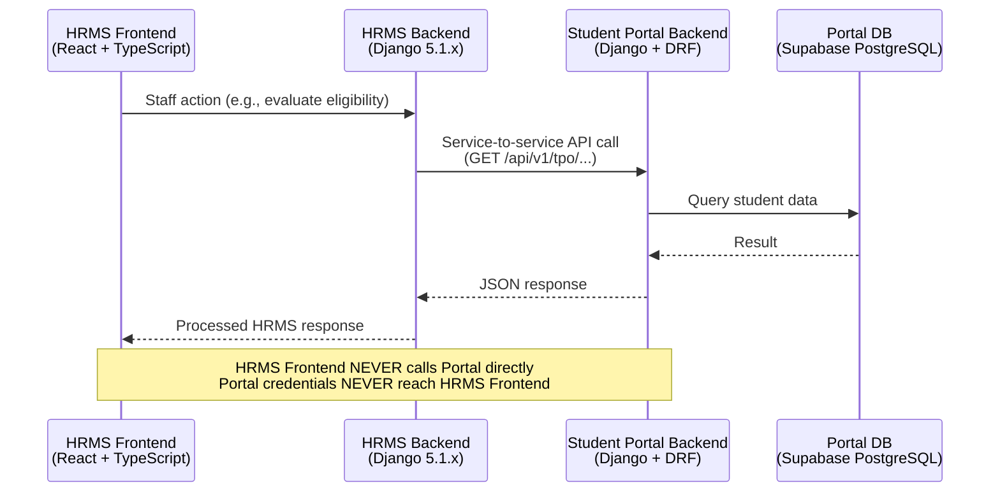
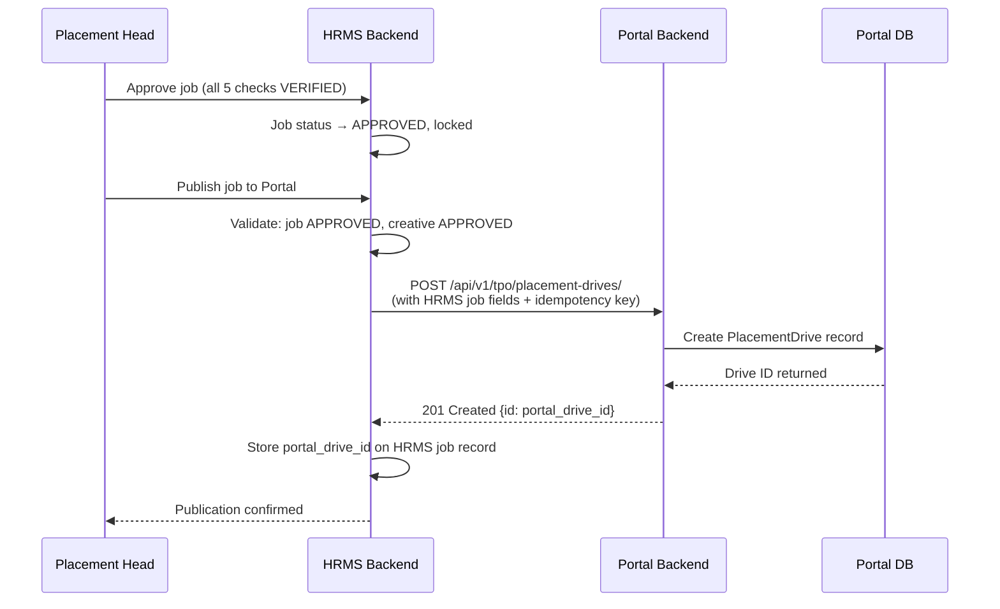

# 06 — Student Portal Integration Discovery

> **Status:** Phase 0 Documentation — Not Approved for Implementation
> **Prepared:** 2026-11-03
> **Document Owner:** GQT Platform Architecture Team
> **Scope:** GQT HRMS Integration with GQT Student Portal

---

## Legend

| Tag | Meaning |
|-----|---------|
| ✅ **CONFIRMED** | Verified from Student Portal codebase inspection |
| 🔵 **PROPOSED** | Architectural recommendation, not yet confirmed |
| ❓ **UNKNOWN** | Information not available; requires Portal team input |
| 🚫 **BLOCKED** | Cannot proceed until a prerequisite decision or action is taken |

---

## Section 1: Integration Overview

### 1.1 Purpose

The GQT HRMS requires access to student academic data managed in the existing **GQT Student Portal** system. The HRMS does not and cannot independently maintain the authoritative source of student identity, academic records, or CGPA. The integration bridge allows the HRMS to:

1. Read student profile data (CGPA, branch, graduation year, course) for eligibility evaluation
2. Publish approved job/placement drives to the Student Portal's `PlacementDrive` model
3. Receive student application data from the Portal's `PlacementApplication` model
4. Send drive announcements to students via the Portal noticeboard

### 1.2 The Two Systems

| System | Role | Technology | Database |
|--------|------|-----------|---------|
| **GQT Student Portal** | System of record for student identity, academic data, and Portal-side placement drives | Django + DRF, SimpleJWT, HttpOnly cookies | Supabase PostgreSQL |
| **GQT HRMS** | System of record for company CRM, job verification/approval, candidate preparation, offer management, and analytics | Django 5.1.x + DRF 3.15+, React + TypeScript + Vite | PostgreSQL 16 |

### 1.3 Integration Pattern

### 1.4 Key Integration Principle

> ✅ **CONFIRMED RULE:** The HRMS backend acts as the sole intermediary for all Student Portal API calls. The HRMS frontend must **never** receive or store Student Portal service credentials. Portal authentication tokens/keys must be stored exclusively as backend environment variables.

---

## Section 2: System of Record Mapping

| Data Entity | System of Record | HRMS Can Read? | HRMS Can Write? | Sync Direction | Notes |
|------------|-----------------|----------------|----------------|----------------|-------|
| **Student Identity** (user account, email, mobile) | Student Portal | ✅ Yes — via TPO API | ❓ UNKNOWN — write-back not confirmed | Portal → HRMS (read) | HRMS must treat Portal as authoritative; local caching requires authorization |
| **Student Profile** (name, college, branch, graduation_year, cgpa, course_opted) | Student Portal (`StudentProfile` model) | ✅ Yes — via TPO dashboard endpoints | 🚫 No — read-only integration assumed | Portal → HRMS (read) | `StudentProfile.cgpa`, `graduation_year`, `course_opted` are sourced from Portal |
| **Student Academic Records** (attendance_percentage, module progress, scores) | Student Portal | ✅ Yes (attendance_percentage on StudentProfile) | 🚫 No | Portal → HRMS (read) | Used for eligibility evaluation |
| **Student Resumes** (uploaded PDFs in Portal) | ❓ UNKNOWN — Portal may hold its own resumes | ❓ UNKNOWN | ❓ UNKNOWN | ❓ UNKNOWN | HRMS maintains its own isolated resume storage; whether Portal resumes are accessible via API is unconfirmed |
| **Student Placement Applications** (`PlacementApplication` model in Portal) | Student Portal | ✅ Yes — Portal has its own PlacementApplication model | ❓ UNKNOWN | Bidirectional? | Status choices: APPLIED, UNDER_REVIEW, SHORTLISTED, SELECTED, REJECTED — potential conflict with HRMS status model |
| **Placement Drives** (`PlacementDrive` model in Portal) | Shared — Portal has its own; HRMS creates authoritative job | HRMS reads Portal's drives | ✅ HRMS publishes to Portal | HRMS → Portal (write) | HRMS-approved job triggers Portal PlacementDrive creation |
| **College/Institution Records** | Student Portal (`StudentProfile.college_id` FK) | ✅ Yes — college_id scoped | 🚫 No | Portal → HRMS | College context used for scoping |
| **Drive Announcements** | HRMS (originator) | N/A | ✅ HRMS sends to Portal noticeboard | HRMS → Portal (push) | Notification delivery to students via Portal channels |

> ❓ **UNRESOLVED:** Whether HRMS should maintain a local copy (shadow record) of student profile data for performance and offline eligibility evaluation, or always call Portal in real-time.

---

## Section 3: Confirmed Portal API Endpoints

> All endpoint information sourced from GQT Student Portal codebase inspection. Status reflects confidence level.

### 3.1 Known Endpoints

| Endpoint | Method | Auth Required | Permission | Description | Status |
|---------|--------|--------------|-----------|-------------|--------|
| `/api/v1/tpo/dashboard/` | `GET` | Yes | `IsTPO` (Bearer JWT) | TPO dashboard overview; college-scoped student and drive summary | ✅ CONFIRMED |
| `/api/v1/tpo/students/` | `GET` | Yes | `IsTPO` | College-scoped student listing | ✅ CONFIRMED (inferred from TPO_DATA_MAPPING.md) |
| `/api/v1/tpo/students/?batch_code=...` | `GET` | Yes | `IsTPO` | Filter students by batch code | ✅ CONFIRMED |
| `/api/v1/tpo/students/?technology=...` | `GET` | Yes | `IsTPO` | Filter students by technology/course | ✅ CONFIRMED |
| `/api/v1/tpo/students/?graduation_year=...` | `GET` | Yes | `IsTPO` | Filter students by graduation year | ✅ CONFIRMED |
| `/api/v1/tpo/students/?search=...` | `GET` | Yes | `IsTPO` | Free-text search across students | ✅ CONFIRMED |
| `/api/v1/tpo/students/{id}/` | `GET` | Yes | `IsTPO` | Individual student profile read (college-scoped) | ✅ CONFIRMED |
| `/api/v1/tpo/placement-drives/` | `GET`, `POST` | Yes | `IsTPO` | List and create placement drives | ✅ CONFIRMED |
| `/api/v1/tpo/placement-drives/{id}/` | `GET`, `PUT`, `PATCH` | Yes | `IsTPO` | Manage individual placement drive | ✅ CONFIRMED |

### 3.2 What Needs Verification

| Unknown | What Is Needed | Priority |
|---------|---------------|---------|
| Rate limits on Portal API | Maximum requests/second or requests/minute to avoid throttling | 🔴 High |
| Pagination scheme details | Page size, page parameter name, total count field | 🔴 High |
| Authentication mechanism for service accounts | Does Portal support non-user service tokens, or only user JWTs? | 🔴 High |
| Student resume access endpoint | Can HRMS retrieve Portal-side resumes via TPO API? | 🟡 Medium |
| Placement application write-back | Can HRMS update Portal PlacementApplication status? | 🟡 Medium |
| Webhook/push notifications from Portal to HRMS | Does Portal support outbound webhooks for student events? | 🟡 Medium |
| Announcement/noticeboard write endpoint | Is there a POST endpoint to publish announcements to Portal noticeboard? | 🟡 Medium |
| Error response schema | What does Portal return on 400/403/404/500? | 🟡 Medium |

---

## Section 4: Integration Authentication Questions

### 4.1 Unresolved Authentication Questions

| Question | Options | Recommendation | Status |
|----------|---------|---------------|--------|
| How will HRMS authenticate to Portal? | (a) Dedicated service account with TPO role JWT; (b) API key header; (c) OAuth2 client credentials | 🔵 Recommend (a) — a dedicated non-human service account with TPO role, credentials stored in HRMS backend env | ❓ UNKNOWN |
| Will HRMS use a user TPO JWT, a separate service token, or another mechanism? | Depends on Portal's auth capability for service accounts | Portal team must confirm service account support | ❓ UNKNOWN |
| Who provisions the service credentials? | GQT IT / Portal team administrator | Must be Portal team action | ❓ UNKNOWN |
| How are credentials rotated? | Manual rotation with env var update + deployment? Automated rotation? | 🔵 Recommend documented rotation runbook | ❓ UNKNOWN |
| Where are credentials stored? | HRMS backend environment variables only | ✅ Must NOT be in frontend, must NOT be in source control | ✅ CONFIRMED principle |
| Is mTLS required for service-to-service calls? | Optional vs required | 🔵 Recommended for production | ❓ UNKNOWN |

### 4.2 Service Account Requirements (Portal Team Must Confirm)

> 🚫 **BLOCKED:** HRMS cannot implement the integration until the following are confirmed by the Portal team:
> 1. Portal must support a dedicated service account that does not belong to a human user
> 2. The service account must hold TPO-equivalent read permissions
> 3. The service account must have write permission for `PlacementDrive` creation
> 4. A credential issuance and rotation procedure must be documented

---

## Section 5: Data Mapping and Validation

### 5.1 Student Profile Data Mapping

| Portal Source Field | Portal Model | HRMS Target Field | HRMS Context | Validation at Boundary | Null Handling |
|--------------------|-------------|-------------------|-------------|----------------------|--------------|
| `cgpa` | `StudentProfile` | Eligibility engine input | `EligibilityEvaluation.student_cgpa` | Must be `0.0 ≤ cgpa ≤ 10.0` (or 0–4.0 if GPA scale) | If null → evaluation cannot complete; status → `PENDING` |
| `graduation_year` | `StudentProfile` | Cohort matching | `CandidateCohort.eligible_batches` | Must be a 4-digit year ≥ current year | If null → ineligible |
| `college_id` | `StudentProfile` (FK) | Institution scoping | HRMS college scope filter | Must reference a known college | If null → student cannot be scoped |
| `attendance_percentage` | `StudentProfile` | Optional eligibility criterion | `EligibilityEvaluation` | Must be `0.0 ≤ pct ≤ 100.0` | If null → skip criterion if not required |
| `course_opted` | `StudentProfile` | Branch/course filter | `JobRequirement.eligible_branches` | String value; normalize casing | If null → may be ineligible |
| `total_points` | `StudentProfile` | ❓ UNKNOWN HRMS use | TBD | TBD | TBD |
| `name` | User model | Display only | Read-only in HRMS | Non-empty string | Alert if missing |
| `email` (institutional) | User model | Student identity key | Uniqueness check | Valid email format + institutional domain | Block registration if missing |

### 5.2 PlacementDrive Field Mapping (HRMS → Portal)

| HRMS Source Field | HRMS Model | Portal Target Field | Portal Model | Notes |
|-------------------|-----------|--------------------|-----------|----|
| `role` | `JobRequirement` | `role` | `PlacementDrive` | Direct mapping |
| `company_name` | `Company` | `company_name` | `PlacementDrive` | From related Company record |
| Eligibility criteria (branch, CGPA, year) | `JobRequirement` | `eligibility_criteria`, `min_cgpa`, `eligible_batches` | `PlacementDrive` | Structured mapping required |
| `application_deadline` | `JobRequirement` | `application_deadline` | `PlacementDrive` | Must be future-dated |
| HRMS Job ID | `JobRequirement.id` | ❓ External reference field | `PlacementDrive` | UNKNOWN — does Portal support an `external_id` field for round-trip correlation? |

> ❓ **UNRESOLVED:** If HRMS creates a `PlacementDrive` in Portal, how does HRMS receive the Portal-assigned drive ID for future updates? Portal must return the created drive's ID in the response.

---

## Section 6: Sync Strategy Questions

| Question | Options | Recommendation | Status |
|----------|---------|---------------|--------|
| Is integration real-time (per-request API call) or periodic batch sync? | (a) Real-time: each eligibility evaluation triggers a live Portal API call; (b) Periodic: nightly sync of student data to HRMS local cache | 🔵 Recommend real-time for accuracy, with caching layer for performance | ❓ UNRESOLVED |
| What is the acceptable staleness threshold for student data? | Real-time (0 staleness) vs 24h cache vs 1h cache | Depends on sync strategy choice | ❓ UNRESOLVED |
| How are conflicts resolved when Portal data and HRMS cache differ? | Portal always wins for student identity and academic records | ✅ Portal is authoritative — HRMS must not override | ✅ CONFIRMED principle |
| What happens when Portal is unavailable? | (a) Fail hard — block operations requiring Portal data; (b) Degrade gracefully — use cached data with staleness warning | 🔵 Recommend (b) with explicit staleness flag | ❓ UNRESOLVED |
| Does HRMS need to cache student data in its own database? | (a) Yes — local shadow records for performance; (b) No — always live API calls | ❓ UNRESOLVED — depends on latency requirements and Portal rate limits | ❓ UNKNOWN |

---

## Section 7: Pagination, Rate Limits, Timeouts

### 7.1 Pagination

| Attribute | Status | Notes |
|-----------|--------|-------|
| Portal API uses `DjangoFilterBackend` | ✅ CONFIRMED | Supports batch_code, technology, graduation_year, date filters, and free-text search |
| Default page size | ❓ UNKNOWN | Must confirm with Portal team (recommend asking for 100 per page minimum) |
| Pagination parameter name (`page`? `offset`? `cursor`?) | ❓ UNKNOWN | |
| Total record count field in response | ❓ UNKNOWN | Critical for HRMS to know when all pages have been fetched |

### 7.2 Rate Limits

| Attribute | Status |
|-----------|--------|
| Portal API rate limits exist? | ❓ UNKNOWN — must confirm with Portal team |
| Requests per minute/hour limit | ❓ UNKNOWN |
| Rate limit response code (likely `429 Too Many Requests`) | 🔵 PROPOSED — HRMS should handle `429` with exponential backoff |
| Whether HRMS service account has elevated rate limits vs regular users | ❓ UNKNOWN |

### 7.3 Timeout Configuration

| Call Type | Recommended Timeout | Status |
|-----------|--------------------| -------|
| Single student profile read | 10 seconds | 🔵 PROPOSED |
| Student list (paginated) | 30 seconds | 🔵 PROPOSED |
| PlacementDrive creation | 15 seconds | 🔵 PROPOSED |
| Bulk sync operations | 120 seconds (with streaming or chunked response) | 🔵 PROPOSED |

### 7.4 Retry Strategy

| Rule | Status |
|------|--------|
| Exponential backoff with jitter on transient failures (5xx, `429`, network timeout) | 🔵 PROPOSED |
| Maximum 3 retry attempts before failing the request and logging an alert | 🔵 PROPOSED |
| No retry on `400 Bad Request` or `403 Forbidden` (non-transient errors) | 🔵 PROPOSED |
| Retry state must be persisted (e.g., Celery task retry) — not in-memory only | 🔵 PROPOSED |

---

## Section 8: Idempotency and Duplicate Prevention

### 8.1 Job/Drive Publication Idempotency

| Scenario | Risk | Mitigation | Status |
|----------|------|-----------|--------|
| HRMS publishes a job to Portal, network fails before receiving response, HRMS retries | Duplicate `PlacementDrive` created in Portal | HRMS should send a stable idempotency key (e.g., HRMS Job ID) in each request; Portal must deduplicate on this key | ❓ UNKNOWN — does Portal support idempotency keys? |
| Staff clicks "Publish to Portal" twice in quick succession | Duplicate drive created | HRMS should enforce `select_for_update` on the publish action; track `portal_drive_id` to detect already-published jobs | 🔵 PROPOSED |

### 8.2 Student Registration Idempotency

| Scenario | Risk | Mitigation | Status |
|----------|------|-----------|--------|
| Student already exists in Portal with same institutional email | HRMS attempts to create duplicate | HRMS should check Portal for existing student before creating; Portal should return existing record on match | ❓ UNKNOWN — Portal merge behavior not confirmed |
| HRMS and Portal have conflicting profile data for same student | Data inconsistency | Portal data always wins; HRMS must refresh from Portal on conflict | ✅ CONFIRMED principle |

### 8.3 Announcement Delivery Deduplication

| Rule | Status |
|------|--------|
| HRMS tracks announcement delivery status per student per job | 🔵 PROPOSED |
| Duplicate announcement delivery prevented by checking delivery log before send | 🔵 PROPOSED |
| Idempotency key: `{hrms_job_id}:{student_id}:{channel}` | 🔵 PROPOSED |

---

## Section 9: Error Handling and Recovery

### 9.1 Portal API Unavailable

| Scenario | HRMS Behavior | Status |
|----------|--------------|--------|
| Portal returns 5xx or connection timeout | HRMS logs error with request ID, returns graceful degraded response to staff user, queues retry via Celery | 🔵 PROPOSED |
| Portal is completely unreachable for extended period | HRMS alert to ADMIN; eligibility evaluations blocked or served from stale cache with staleness warning | 🔵 PROPOSED |
| Portal returns 503 Service Unavailable | Treat as transient; exponential backoff retry | 🔵 PROPOSED |

### 9.2 Unexpected Schema from Portal

| Scenario | HRMS Behavior | Status |
|----------|--------------|--------|
| Portal response is missing an expected field | HRMS logs warning, falls back to None/default, does NOT crash | 🔵 PROPOSED |
| Portal response has unexpected additional fields | HRMS ignores unknown fields (strict schema validation, no pass-through) | 🔵 PROPOSED |
| Portal returns HTML error page instead of JSON | HRMS detects non-JSON `Content-Type`, logs critical alert, returns 503 to caller | 🔵 PROPOSED |

### 9.3 Data Reconciliation

| Rule | Status |
|------|--------|
| Manual reconciliation process needed for data divergence between Portal and HRMS | 🔵 PROPOSED |
| HRMS must expose a staff-only "Sync from Portal" action to refresh a student's HRMS profile from Portal | 🔵 PROPOSED |
| Full reconciliation run (all students) available to `ADMIN` only | 🔵 PROPOSED |
| Reconciliation differences logged to audit log | 🔵 PROPOSED |

---

## Section 10: Student Drive and Announcement Publishing

### 10.1 Job Publication Flow

### 10.2 Required Fields for Drive Publication

| HRMS Field | Required for Portal? | Notes |
|-----------|---------------------|-------|
| `company_name` | ✅ Yes | |
| `role` | ✅ Yes | |
| `eligibility_criteria` | ✅ Yes | May need formatting for Portal |
| `min_cgpa` | ✅ Yes | |
| `eligible_batches` (graduation years) | ✅ Yes | |
| `application_deadline` | ✅ Yes | |
| HRMS Job ID (as external reference) | ✅ Recommended | Enables round-trip correlation |
| Creative asset URL | ❓ UNKNOWN | Does Portal display the flyer? |

### 10.3 Publication Trigger

| Rule | Status |
|------|--------|
| Only `PLACEMENT_HEAD` or `ADMIN` can trigger publish to Portal | ✅ CONFIRMED (per `CanPublishJobs` permission) |
| Job must be in `APPROVED` status before publish is available | ✅ CONFIRMED |
| Creative asset must be in `APPROVED` status before publish (optional gating?) | ❓ UNRESOLVED |

### 10.4 Post-Publication Acknowledgement

| Rule | Status |
|------|--------|
| Portal returns created `PlacementDrive` ID; HRMS stores this as `portal_drive_id` | 🔵 PROPOSED |
| HRMS job record transitions to `PUBLISHED_TO_PORTAL` status after successful publish | 🔵 PROPOSED |
| Failed publish returns HRMS job to `APPROVED` status with error logged | 🔵 PROPOSED |

---

## Section 11: Audit Events for Integration

> 🔵 **PROPOSED RULE:** All cross-system API calls must generate an audit log entry in HRMS.

### 11.1 Required Audit Log Fields for Integration Events

| Field | Description |
|-------|-------------|
| `timestamp` | ISO 8601 UTC timestamp of the call |
| `request_id` | Unique identifier for the HRMS request (traceable through logs) |
| `portal_endpoint` | The Portal API path called (e.g., `/api/v1/tpo/students/`) |
| `http_method` | `GET`, `POST`, `PATCH`, etc. |
| `response_status_code` | HTTP status returned by Portal |
| `response_latency_ms` | Time taken for Portal to respond |
| `hrms_actor` | The HRMS staff user who triggered the action (if user-initiated) |
| `data_entity_type` | Type of entity involved (e.g., `StudentProfile`, `PlacementDrive`) |
| `data_entity_id` | HRMS-side ID of the entity |
| `portal_entity_id` | Portal-side ID if returned |
| `outcome` | `SUCCESS`, `FAILURE`, `RETRY`, `DEGRADED` |

### 11.2 Sensitive Data Redaction in Integration Logs

| Rule | Status |
|------|--------|
| Portal service account credentials must never appear in logs | ✅ CONFIRMED principle |
| Student CGPA and personal data in request/response bodies must be redacted from debug logs | 🔵 PROPOSED |
| Response bodies must not be logged at INFO level; only metadata and status codes | 🔵 PROPOSED |
| Full response bodies may be logged at DEBUG level (disabled in production) | 🔵 PROPOSED |

### 11.3 Integration Error Alerting

| Rule | Status |
|------|--------|
| Integration failures must trigger alert to `ADMIN` role | 🔵 PROPOSED |
| Alert threshold: 3 consecutive failures to the same Portal endpoint | 🔵 PROPOSED |
| Alerts delivered via: email notification + HRMS admin dashboard alert | 🔵 PROPOSED |

---

## Section 12: Contract Versioning

### 12.1 Current API Version

| Attribute | Value | Status |
|-----------|-------|--------|
| Portal API base version | `/api/v1/` | ✅ CONFIRMED |
| HRMS must pin to Portal API v1 | Required | 🔵 PROPOSED |
| URL prefix in HRMS config | `PORTAL_API_BASE_URL` env var + `/api/v1/` | 🔵 PROPOSED |

### 12.2 Breaking Change Management

| Rule | Status |
|------|--------|
| Portal team must notify HRMS team before deprecating or modifying any endpoint used by HRMS | 🔵 PROPOSED — needs formal agreement with Portal team |
| HRMS integration layer must have an abstraction (adapter/client class) so Portal API changes require only one-point updates | 🔵 PROPOSED |
| HRMS must log the Portal API version in integration audit logs | 🔵 PROPOSED |
| What is the notification period before a Portal API breaking change? | ❓ UNKNOWN — needs SLA agreement with Portal team |

### 12.3 Contract Tests

| Rule | Status |
|------|--------|
| Contract tests (Pact or equivalent) required before production integration | 🔵 PROPOSED |
| HRMS must maintain a mock Portal server for local development and CI | 🔵 PROPOSED |
| Contract tests run in CI against the mock Portal server | 🔵 PROPOSED |
| Contract tests run against Portal staging environment before each release | 🔵 PROPOSED |
| Contract tests are a release gate — no production deployment without passing contract tests | 🔵 PROPOSED |

### 12.4 Version Negotiation

| Question | Status |
|----------|--------|
| Does Portal expose an API version negotiation endpoint? | ❓ UNKNOWN |
| Will Portal support v2 of any endpoints while HRMS is still on v1? | ❓ UNKNOWN — needs Portal team response |

---

## Section 13: Security Boundaries

### 13.1 Credential Security

| Rule | Status |
|-----|--------|
| HRMS frontend must NEVER receive Portal service credentials | ✅ CONFIRMED principle |
| Portal credentials stored exclusively as HRMS backend environment variables | ✅ CONFIRMED principle |
| Portal credentials must not appear in HRMS source code, version control, logs, or frontend responses | ✅ CONFIRMED |
| Credential rotation procedure must be documented and tested | ❓ UNKNOWN — needs runbook |

### 13.2 Student Data Caching Authorization

| Rule | Status |
|------|--------|
| Portal student data must not be persisted in HRMS database without explicit authorization from GQT data governance | 🔵 PROPOSED |
| If local caching is authorized: cached records must have TTL, staleness flags, and deletion schedule | 🔵 PROPOSED |
| Caching student PII (name, email, phone) in HRMS database requires data processing justification | ❓ UNRESOLVED — needs GQT legal/compliance review |
| CGPA and academic metrics caching: acceptable if covered by institutional data policy | ❓ UNRESOLVED |

### 13.3 Cross-Origin Data Exposure

| Rule | Status |
|------|--------|
| HRMS API responses must not include raw Portal API response objects — only mapped/transformed fields | 🔵 PROPOSED |
| HRMS must not act as a transparent proxy to the Portal API | ✅ CONFIRMED principle |
| Any Portal data surfaced in HRMS frontend must pass through HRMS serializers and permission checks | ✅ CONFIRMED |
| Portal's internal error messages must not be forwarded to HRMS frontend | 🔵 PROPOSED |

### 13.4 Network Security

| Rule | Status |
|------|--------|
| HRMS backend → Portal backend calls must use HTTPS (TLS 1.2+) | 🔵 PROPOSED |
| Portal's server certificate must be validated (no `verify=False`) | 🔵 PROPOSED |
| IP allowlisting for HRMS service account access to Portal | ❓ UNKNOWN — does Portal support IP allowlisting? |
| VPN or private network channel between HRMS and Portal backends in production | ❓ UNKNOWN |

---

## Section 14: Open Questions Summary

> A consolidated checklist of all items requiring Portal team input or GQT decision.

### Portal Team Must Confirm

| # | Question | Priority |
|---|----------|---------|
| PT-001 | Does Portal support a dedicated non-human service account with TPO role? | 🔴 Critical |
| PT-002 | What is the Portal API rate limit for service accounts? | 🔴 Critical |
| PT-003 | What is the Portal API pagination scheme (page size, parameter names, total count field)? | 🔴 Critical |
| PT-004 | What does Portal return on 400/403/404/500 errors (response schema)? | 🔴 Critical |
| PT-005 | Does Portal support an external reference ID on `PlacementDrive` for HRMS correlation? | 🔴 Critical |
| PT-006 | Is there a Portal endpoint to publish announcements to the student noticeboard? | 🟡 High |
| PT-007 | Can HRMS access student resumes stored in Portal via the TPO API? | 🟡 High |
| PT-008 | Can HRMS write back `PlacementApplication` status updates to Portal? | 🟡 High |
| PT-009 | Does Portal support idempotency keys on `PlacementDrive` creation? | 🟡 High |
| PT-010 | What is the notification SLA for breaking API changes? | 🟡 High |
| PT-011 | Does Portal support IP allowlisting for the HRMS service account? | 🟢 Medium |
| PT-012 | Does Portal support webhook callbacks for student application events? | 🟢 Medium |

### GQT Must Decide

| # | Question | Priority |
|---|----------|---------|
| GQT-001 | Is real-time or periodic sync the preferred integration pattern? | 🔴 Critical |
| GQT-002 | Is HRMS authorized to cache student PII in its own database? | 🔴 Critical |
| GQT-003 | What is the acceptable staleness threshold for student data in eligibility evaluation? | 🟡 High |
| GQT-004 | Should creative asset approval be required before publishing a job to Portal? | 🟡 High |
| GQT-005 | Who is responsible for Portal service account provisioning and rotation? | 🟡 High |

---

*End of Document 06 — Student Portal Integration Discovery*
