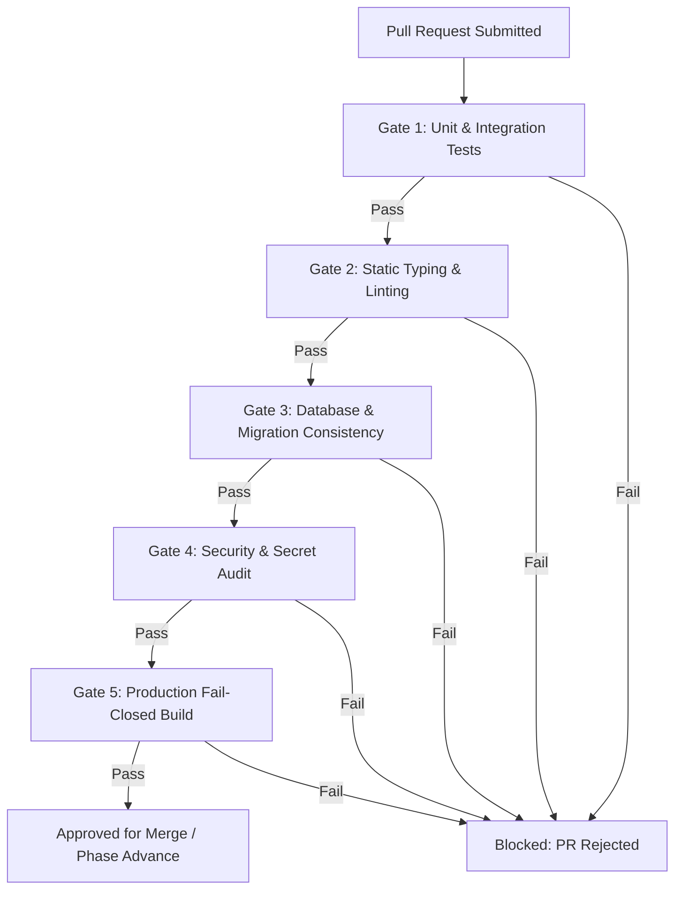

# 10 — Phase Roadmap and Quality Gates
**GQT HRMS & Recruitment CRM Platform**  
**Document Status:** Phase 0 Documentation — Proposed Delivery Roadmap (Not Approved for Implementation)  
**Document ID:** GQT-DOC-P0-010  
**Prepared:** 2026-11-03  
**Author:** Software Architecture & QA Working Group  

---

## 1. Engineering Roadmap Overview

The GQT HRMS & Recruitment CRM Platform is planned as a 16-phase structured delivery lifecycle (Phase 0 through Phase 15). Each phase represents a cohesive engineering increment guarded by strict, non-negotiable **Quality Gates**.

Advancement to subsequent phases is strictly barred until all entry criteria, test invariants, and verification gates of the preceding phase are formally certified.

---

## 2. Multi-Phase Implementation Roadmap

| Phase | Title & Focus Area | Key Architectural Deliverables | Entry Criteria | Exit Criteria | Est. Effort |
|:---|:---|:---|:---|:---|:---:|
| **Phase 0** | **Discovery & Baseline** | Requirements baseline, traceability matrix, ADRs, threat model, acceptance report | Project commissioning brief | All 14 Phase 0 acceptance gates passed (Doc only) | 1 Cycle |
| **Phase 1** | **Scaffold & Env Setup** | Monorepo layout, Docker definitions, PostgreSQL staging, Vite setup, CI/CD pipeline | Phase 0 GQT approval & OD-001 decision | Clean builds, CI green on PostgreSQL 16 & Vitest | 1-2 Cycles |
| **Phase 2** | **Core & RBAC** | Custom UUID User, Role models, Argon2, JWT HttpOnly cookies, Audit Trail model | Phase 1 sign-off | Auth test suite passing (30+ tests), zero token in web storage | 2 Cycles |
| **Phase 3** | **Corporate CRM** | Company directory, HR contacts, outreach touchpoints, daily quota counters | Phase 2 sign-off | Domain collision duplicate test passed, 100/day touchpoint aggregator | 2 Cycles |
| **Phase 4** | **Job Management** | Structured JD intake, 5-point verification checklist, Placement Head approval gate | Phase 3 sign-off | Premature approval rejected (HTTP 400), JD lock verified | 2 Cycles |
| **Phase 5** | **Creative Studio** | Creative asset requests, multi-channel versioning, 4-point design checks, approvals | Phase 4 sign-off | SVG upload rejected, binary magic byte check passed | 1-2 Cycles |
| **Phase 6** | **Students & Eligibility** | Profile vaults, private PDF resumes, deterministic eligibility engine, cohort lock | Phase 5 sign-off | Object-level isolation verified (403), deterministic engine tested | 2 Cycles |
| **Phase 7** | **Student Preparation** | Resume rubrics, aptitude/tech assessments, mock interview scorecards, Step 23 gate | Phase 6 sign-off | Step 23 certification gate blocks uncertified candidates | 2 Cycles |
| **Phase 8** | **Submissions & Dispatch**| Master candidate Excel roster (`openpyxl`), SHA-256 package hash, dispatch lock | Phase 7 sign-off | Concurrency lock (`select_for_update`) tested, cell formula sanitization | 2 Cycles |
| **Phase 9** | **Interview Tracking** | Recruiter shortlist intake, multi-round scheduling, idempotent reminder workers | Phase 8 sign-off | Evaluator notes hidden from student, reminders deduplicated | 2 Cycles |
| **Phase 10** | **Placements & Offers** | Selection intake, private offer letter vault, student acceptance, joining audit | Phase 9 sign-off | Offer streaming authenticated, immutable student acceptance | 2 Cycles |
| **Phase 11** | **Feedback & Reports** | 360° feedback loops (student/HR/trainer), placement KPI funnels, CSV exports | Phase 10 sign-off | k-anonymity masking verified, formula injection sanitized | 1-2 Cycles |
| **Phase 12** | **Portal Integration** | Scoped REST integration client, service token auth, stale data alerts | Phase 11 sign-off | Zero portal secrets in frontend, mock integration tests pass | 2 Cycles |
| **Phase 13** | **Continuous Imprv** | Remedial training plans, skill gap matrices, recruitment cycle post-mortems | Phase 12 sign-off | Automated SLA follow-up worker verified | 1 Cycle |
| **Phase 14** | **Security Hardening** | Fail-closed production settings, penetration test audit, performance benchmarks | Phase 13 sign-off | OWASP Top 10 validated, zero High/Critical vulnerabilities | 2 Cycles |
| **Phase 15** | **Production Go-Live** | Production deployment (VPS/Supabase), DNS cutover, staff training, live release | Phase 14 sign-off | Health check HTTP 200, zero data leakage in production logs | 1 Cycle |

---

## 3. Universal Quality Gate Framework

Every pull request and phase release must satisfy the **Universal Quality Gate** before code can be merged into `main` or advanced to the next phase:

### Detailed Universal Gate Invariants
1. **Automated Test Suite Execution:**
   - Backend: `pytest` must run with **0 failures and 0 errors**.
   - Frontend: `npm run test` (Vitest) must run with **0 failures**.
2. **Strict Static Typing:**
   - Frontend: `tsc -b --noEmit` must complete with exit code `0`.
   - Backend: Static typing via `mypy` or `pyright` must raise 0 blocking errors.
3. **Database Migration Integrity:**
   - `python manage.py makemigrations --check --dry-run` must return `No changes detected`.
   - All migrations must execute bidirectionally (apply and rollback clean).
4. **Zero Embedded Secrets or Credentials:**
   - Automated git pre-commit scanning rejects raw keys, passwords, or tokens.
   - All environment variables documented in `.env.example`.
5. **Log Redaction & Sanitization:**
   - Test suites verify `SensitiveDataFilter` scrubs passwords, JWTs, and secret keys from application logs.
6. **Code Style & Linting:**
   - Backend: `ruff check` / `flake8` clean.
   - Frontend: `eslint` clean.
7. **Production Fail-Closed Configuration:**
   - `python manage.py check --deploy` passes without critical warnings.

---

## 4. Phase-Specific Quality Gates

### Phase 0 Exit Gate (Discovery Baseline)
- [x] Workspace inspection complete; clean state verified.
- [x] Predecessor codebase at `HRS stop in middle` inventoried and isolated.
- [x] 41 workflow steps and 13 phases mapped to 13 modular applications.
- [x] 18 Architecture Decision Records drafted and classified.
- [x] Data classification and 20 security threat scenarios documented.
- [x] Zero application code, migrations, or live resources created.

### Phase 2 Exit Gate (Identity & Core RBAC)
- [ ] JWT cookies verified with `HttpOnly`, `SameSite=Lax`, and `Secure` flags.
- [ ] Attempting to access protected endpoints without credentials returns HTTP 401.
- [ ] Role escalation attempt returns HTTP 403.
- [ ] Password hashing verified using Argon2id with salt.
- [ ] Token refresh blacklist verified on user logout.

### Phase 4 Exit Gate (Job Management & Verification)
- [ ] Job description creation enforces 10 required structured fields.
- [ ] 5-point verification checklist enforces individual validation criteria.
- [ ] Attempting to approve job with `< 5` verified checklist items returns HTTP 400.
- [ ] Only `PLACEMENT_HEAD` or `ADMIN` can execute the approval action.
- [ ] Approved job is locked against mutations (`PUT`/`PATCH` returns 403).

### Phase 6 Exit Gate (Students & Eligibility Engine)
- [ ] Resume upload verifies `%PDF-` binary magic bytes; non-PDF rejected.
- [ ] Student A cannot download Student B's resume (HTTP 403 verified).
- [ ] Eligibility engine produces deterministic pass/fail breakdown across CGPA, branch, and backlogs.
- [ ] Manual eligibility override requires mandatory reason text and records staff ID.
- [ ] Candidate cohort lock prevents subsequent student additions.

### Phase 8 Exit Gate (Candidate Submissions & Roster)
- [ ] Submitting candidate without Step 23 readiness certification raises validation error.
- [ ] Master candidate Excel file generated with SHA-256 package digest.
- [ ] Spreadsheet formulas sanitized against CSV/Excel injection (`'`, `=`, `+`, `-`, `@`).
- [ ] Concurrency safety verified: Simultaneous dispatches locked via `select_for_update()`.

### Phase 10 Exit Gate (Placements & Offers)
- [ ] Offer letters uploadable strictly for candidates in `SELECTED` status.
- [ ] Offer letter downloaded strictly via authenticated streaming endpoint.
- [ ] Student offer acceptance/rejection is immutable once submitted.
- [ ] Joining status audit records state changes (`JOINED`, `NOT_JOINED`, `DEFERRED`).

### Phase 12 Exit Gate (Student Portal Integration)
- [ ] HRMS backend communicates with Student Portal strictly via backend REST client.
- [ ] Zero portal credentials present in client frontend bundle (`VITE_` variables audited).
- [ ] Timeout, retry with backoff, and circuit breaker behavior verified under simulated portal downtime.

---

## 5. Test Coverage Standards

| Domain Layer | Target Line Coverage | Target Branch Coverage | Mandatory 100% Coverage Paths |
|:---|:---:|:---:|:---|
| **Authentication & RBAC** | $\ge 90\%$ | $\ge 85\%$ | Token issuance, cookie flags, role guards, logout blacklist |
| **Object-Level Authorization** | $\ge 95\%$ | $\ge 90\%$ | Resume download, offer letter streaming, evaluator note stripping |
| **Workflow State Machines** | $\ge 90\%$ | $\ge 85\%$ | 5-point job gate, Step 23 certification, cohort lock |
| **Financial / CTC Calculations** | $\ge 95\%$ | $\ge 90\%$ | Salary min/max validation, placement package aggregations |
| **File Ingress & Egress** | $\ge 90\%$ | $\ge 85\%$ | PDF magic bytes, 5MB size limit, formula injection escaping |
| **General Domain Services** | $\ge 80\%$ | $\ge 75\%$ | Standard CRUD, selectors, filter backends |
| **Frontend UI Components** | $\ge 75\%$ | $\ge 70\%$ | Protected routes, authentication context, form validations |

---

## 6. Definition of Done (DoD)

A functional feature or workflow step is certified as **DONE** only when all 10 conditions are satisfied:

1. **Architecture Conformance:** Implementation follows the 5-tier pattern (Models &rarr; Selectors &rarr; Services &rarr; Serializers &rarr; Views).
2. **Strict Authorization:** Endpoint enforces deny-by-default role permissions and object-level ownership checks.
3. **Data Integrity:** Database constraints, foreign key protections (`PROTECT`), and unique constraints enforced.
4. **Automated Unit & Integration Tests:** Pytest (backend) and Vitest (frontend) test suites cover happy paths, validation failures, and unauthorized attempts.
5. **Frontend State Handling:** React view handles `Loading`, `Empty`, `Error`, `Offline`, and `Permission-Denied` states explicitly.
6. **Accessible UI:** Follows GQT brand palette tokens, maintains WCAG 2.1 AA contrast, and avoids color-only indicators.
7. **OpenAPI Schema Alignment:** `drf-spectacular` schema updated and verified without warnings.
8. **Audit Trail Logging:** State mutations trigger structured audit entries in `GlobalAuditTrail`.
9. **Zero-Secret Compliance:** No credentials, tokens, or live URLs committed or logged.
10. **Code Review Certification:** Peer reviewed and approved against the Universal Quality Gate.

---

## 7. Cross-References

- Baseline environment findings &rarr; `00-project-baseline.md`
- 41-step requirements traceability &rarr; `02-requirements-traceability.md`
- Module inventory & specifications &rarr; `03-module-inventory.md`
- Proposed Architecture & ADRs &rarr; `07-proposed-system-architecture.md` / `09-architecture-decision-records.md`
- Open decisions blocking Phase 1 &rarr; `11-open-decisions-and-assumptions.md`
- Phase 0 acceptance gate &rarr; `12-phase-0-acceptance-report.md`

