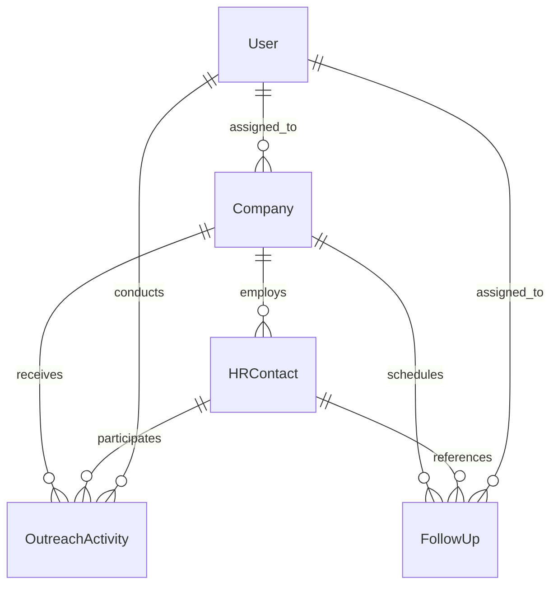

# GQT HRMS & Recruitment CRM Platform — Phase 2: CRM Domain Architecture

## 1. Domain Scope

Phase 2 implements the recruitment CRM foundation for Global Quest Technologies (GQT), encompassing:
- Company acquisition and corporate employer database.
- HR recruiter contact hierarchy and relationship management.
- Multi-channel calling and outreach touchpoint tracking.
- Actionable follow-up scheduling, task management, and overdue queues.

---

## 2. Five-Layer Architectural Design

The implementation adheres strictly to the five-layer architectural standard:
```
[Client / UI] ──▶ [Views: apps.crm.views]
                        │
                        ▼
                [Serializers: apps.crm.serializers]
                        │
                        ▼
                [Services: apps.crm.services]  (Transactional Writes & AuditLog)
                        ▲
                        │
                [Selectors: apps.crm.selectors] (Optimized Queries & Prefetches)
                        │
                        ▼
                [Models: apps.crm.models]       (ORM, Constraints & Normalization)
```

---

## 3. Data Models & Entity Relationships



### 3.1 Company (`crm_company`)
- **Primary Key**: UUIDv4 (`id`).
- **Core Attributes**: `name`, `normalized_name`, `website`, `canonical_domain`, `industry`, `source`, `status`, `tier`, `notes`.
- **Foreign Keys**: `assigned_to` (`accounts.User`), `created_by` (`accounts.User`), `updated_by` (`accounts.User`).
- **Normalization Invariants**:
  - `normalized_name`: Automated lowercase string with corporate entity suffixes stripped (e.g. "Infosys Technologies Pvt. Ltd." &rarr; "infosys technologies").
  - `canonical_domain`: Extracted root domain from URL (e.g. `https://www.google.com/jobs` &rarr; `google.com`).
- **Indexes**: `status + assigned_to`, `canonical_domain`, `normalized_name`.

### 3.2 HRContact (`crm_hr_contact`)
- **Primary Key**: UUIDv4 (`id`).
- **Foreign Keys**: `company` (`crm.Company`, `on_delete=CASCADE`), `assigned_to`, `created_by`, `updated_by`.
- **Core Attributes**: `name`, `designation`, `department`, `email`, `phone`, `alternate_phone`, `linkedin_url`, `preferred_channel`, `status`, `is_primary`, `notes`.
- **Primary Contact Invariant**: Only one HR contact per company may be designated `is_primary=True`. When a new primary contact is saved, existing primary contacts are automatically demoted.

### 3.3 OutreachActivity (`crm_outreach_activity`)
- **Primary Key**: UUIDv4 (`id`).
- **Foreign Keys**: `company` (`crm.Company`), `contact` (`crm.HRContact`, optional), `executive` (`accounts.User`).
- **Core Attributes**: `attempted_at` (timezone-aware UTC), `channel` (`PHONE`, `EMAIL`, `WHATSAPP`, `LINKEDIN`, `IN_PERSON`, `OTHER`), `outcome` (`INTERESTED`, `FOLLOW_UP_REQUESTED`, `MEETING_SCHEDULED`, `REQUIREMENT_SHARED`, `NOT_INTERESTED`, `CALL_NOT_ANSWERED`, `WRONG_NUMBER`, `GATEKEEPER_BLOCKED`), `notes`, `next_action`, `follow_up_date`.
- **Dynamic Progression**: Positive outcomes (`INTERESTED`, `REQUIREMENT_SHARED`) automatically advance the company's lifecycle status from `LEAD`/`CONTACTED` to `ENGAGED`.

### 3.4 FollowUp (`crm_follow_up`)
- **Primary Key**: UUIDv4 (`id`).
- **Foreign Keys**: `company` (`crm.Company`), `contact` (`crm.HRContact`, optional), `outreach_activity` (`crm.OutreachActivity`, optional), `assigned_to` (`accounts.User`), `completed_by` (`accounts.User`, optional).
- **Core Attributes**: `title`, `description`, `due_date`, `priority` (`LOW`, `MEDIUM`, `HIGH`, `URGENT`), `status` (`PENDING`, `COMPLETED`, `RESCHEDULED`, `CANCELLED`), `completed_at`, `cancellation_reason`.
- **Integrity Rule**: Follow-ups never disappear when an HR contact becomes inactive or changes organization.

---

## 4. Company Deduplication Policy

1. **No Automatic Destructive Merging**: System never automatically merges, deletes, or overwrites companies.
2. **Pre-Flight Diagnostic Endpoint**: `POST /api/v1/crm/companies/check-duplicate/` accepts name and website, returning matching records with match reasons (`EXACT_DOMAIN_MATCH` or `NORMALIZED_NAME_MATCH`).
3. **Hard Domain Conflict Guard**: Company creation fails with a `ValidationError` if an existing company shares the exact canonical domain, unless the user provides an explicit confirmation flag (`allow_duplicate=True`) designating it as an authorized subsidiary or distinct legal entity.

