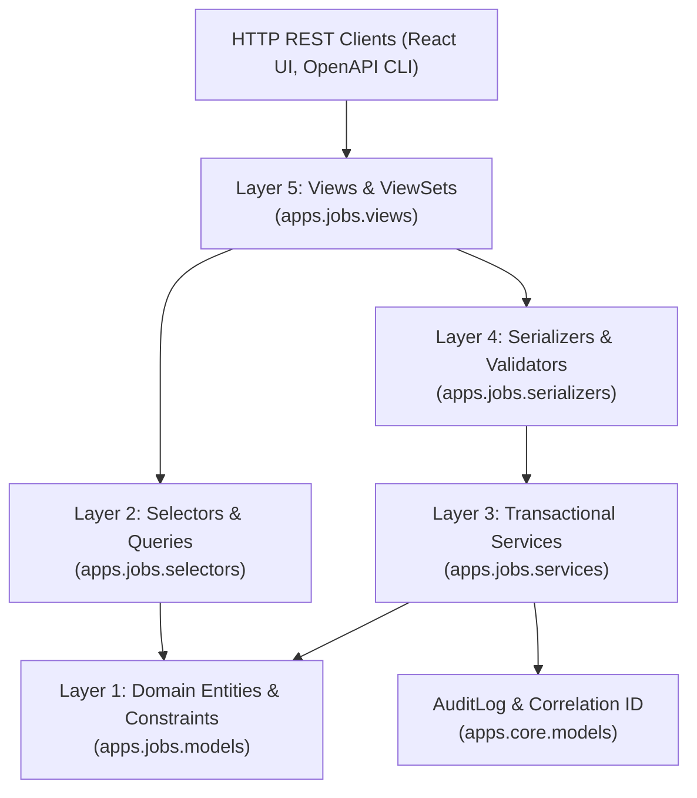

# GQT HRMS & Recruitment CRM Platform — Phase 3 Domain Architecture
## Document: `docs/phase-3/00-jobs-domain-architecture.md`
**Author:** Senior Software Architect, Security Architect, Database Architect  
**Status:** Approved & Verified Baseline  
**Workspace:** `C:\Users\User\Documents\GQT HRMS`  
**Application:** `backend/apps/jobs/` (MOD-003)  

---

## 1. Executive Summary & Domain Scope

Phase 3 implements the **Job Requirements, 5-Point Verification, and Segregated Approval Pipeline** for Global Quest Technologies (GQT). 

The primary business objective is to eliminate fraudulent, inaccurate, or predatory job descriptions (JDs) before they can be released to students or converted into placement drives. It formalizes a rigorous quality control mechanism through five independent verification checks, enforces strict Segregation of Duties (SoD) between Placement Officers and Placement Heads, protects historical records through non-destructive foreign key deletion policies (`models.PROTECT`), and invalidates previously verified checklist gates whenever material job parameters are edited.

---

## 2. Five-Layer Architecture Implementation

Following the approved architectural blueprint, the domain is organized into five strict decoupled layers:

### Layer 1: Domain Models (`backend/apps/jobs/models.py`)
- **`JobRequirement`**: Central aggregate entity storing structured job specifications, academic eligibility thresholds (min CGPA, min percentage, permissible backlogs, eligible branches/batches), compensation packages (min/max CTC LPA, stipend, fixed/variable breakdown), work arrangements, bond parameters, interview schedules, workflow states, and approval attribution.
- **`JobVerificationCheck`**: Five independent rows per job requirement covering each mandatory gate (`ELIGIBILITY`, `SALARY_AUTHENTICITY`, `COMPANY_AUTHENTICITY`, `INTERVIEW_PROCESS`, `REGISTRATION_DEADLINE`), with evaluation statuses (`PENDING`, `VERIFIED`, `FLAGGED`, `REJECTED`), reviewer attribution, evidence reference, and invalidation flags.
- **`JobWorkflowHistory`**: Append-only transition audit log capturing every state progression, reviewer action, and documented justification.

### Layer 2: Selectors (`backend/apps/jobs/selectors.py`)
- Encapsulates all query operations with `select_related('company', 'submitted_by', 'assigned_verifier', 'approved_by', 'rejected_by')` and `prefetch_related('verification_checks', 'workflow_history')`.
- Provides specialized filtered querysets for `list_jobs()`, `list_verification_queue()`, `list_approval_queue()`, and `get_job_workflow_metrics()`.

### Layer 3: Transactional Services (`backend/apps/jobs/services.py`)
- Enforces `@transaction.atomic` and row-level locking via `select_for_update()`.
- Implements material field change detection: automatically invalidates affected verification gates and drops jobs from `PENDING_APPROVAL` to `UNDER_VERIFICATION` upon material alterations.
- Enforces Segregation of Duties: blocks self-approval by submitting Placement Officers.
- Guarantees 100% completion of all 5 mandatory checks before permitting approval.
- Enforces mandatory documented justifications for rejections and change requests.
- Integrates audit logging with correlation ID tracing.

### Layer 4: Serializers (`backend/apps/jobs/serializers.py`)
- Enforces strict input validation on CTC package numbers, boundary percentages, and CGPA ranges.
- Defines clear output representations: `JobRequirementListSerializer` for high-performance table views, `JobRequirementDetailSerializer` for comprehensive reviews, and specialized serializers for actions and check evaluations.

### Layer 5: Views & ViewSets (`backend/apps/jobs/views.py`)
- RESTful ViewSet with custom action endpoints (`submit/`, `assign-verifier/`, `request-changes/`, `approve/`, `reject/`, `amend/`, `checks/`, `history/`).
- Standardized pagination via `StandardResultsSetPagination`.
- Decorated with drf-spectacular schema decorators for OpenAPI 3.1 documentation.

---

## 3. Data Integrity & Invalidation Mapping

Whenever a job specification is updated, the service layer evaluates which material attributes have changed and automatically invalidates the corresponding verification checks:

| Verification Gate | Dependent Material Fields | Invalidation Action |
|:---|:---|:---|
| **`ELIGIBILITY`** | `min_cgpa`, `min_percentage`, `eligible_batches`, `eligible_branches`, `max_backlogs_allowed` | Check status reset to `PENDING`; `requires_reverification = True` |
| **`SALARY_AUTHENTICITY`** | `min_ctc_lpa`, `max_ctc_lpa`, `stipend_amount`, `salary_details` | Check status reset to `PENDING`; `requires_reverification = True` |
| **`COMPANY_AUTHENTICITY`** | `company` | Check status reset to `PENDING`; `requires_reverification = True` |
| **`INTERVIEW_PROCESS`** | `interview_rounds`, `interview_process_notes`, `has_bond`, `bond_duration_months`, `bond_details` | Check status reset to `PENDING`; `requires_reverification = True` |
| **`REGISTRATION_DEADLINE`** | `registration_deadline`, `interview_date` | Check status reset to `PENDING`; `requires_reverification = True` |

If a job is currently in `PENDING_APPROVAL` and any check is invalidated, the job is immediately dropped back to `UNDER_VERIFICATION` status.

