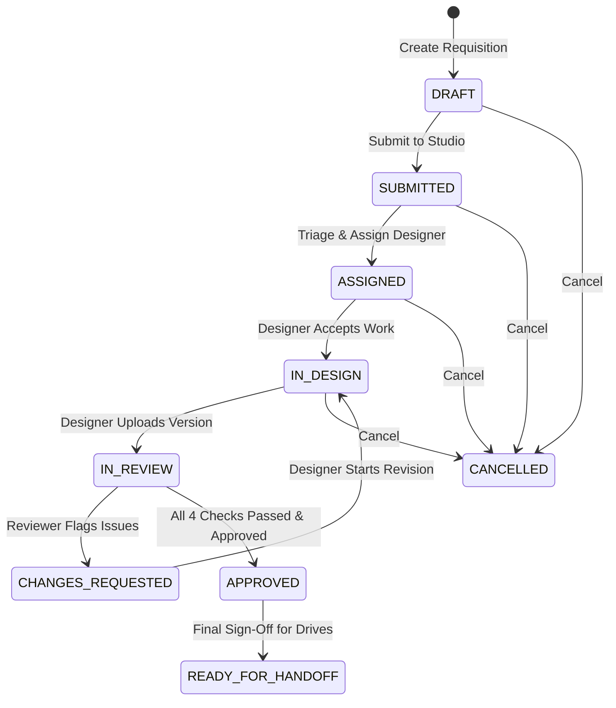

# GQT HRMS — Phase 4: Creative Studio & Design Asset Approval Architecture

## 1. Executive Summary & Objective

The **Creative Studio & Design Asset Approval** module (`apps.creatives`, Blueprint MOD-004) manages recruitment marketing collaterals, campus drive announcements, social flyers, and student outreach assets.

Its primary mission is to:
1. Provide a closed-loop design task workflow from initial recruitment requirement brief to final brand-approved asset handoff.
2. Maintain strict segregation of duties (SoD) between graphic designers and review approvers.
3. Guarantee upload security and asset immutability with cryptographically verifiable checksums (SHA-256) and strict magic-byte MIME validation.
4. Enforce mandatory 4-point design compliance checks before any asset is authorized for student distribution or placement drive publishing.

---

## 2. Five-Layer Architecture Implementation

Following the mandated GQT HRMS 5-layer architecture:

```
┌─────────────────────────────────────────────────────────────┐
│ 1. Presentation & HTTP Layer (views.py, urls.py)            │
│    - CreativeRequestViewSet, CreativeAssetVersionViewSet   │
│    - Authenticated Streamed Download View                  │
│    - Queue Views (Triage, Designer, Review, Handoff)        │
├─────────────────────────────────────────────────────────────┤
│ 2. Serialization & Validation Layer (serializers.py)        │
│    - Request serializers with brief & dimension validation │
│    - Asset upload multipart serializer with file checks    │
│    - Review & Checklist decision serializers               │
├─────────────────────────────────────────────────────────────┤
│ 3. Transactional Business Service Layer (services.py)       │
│    - Atomic workflows with select_for_update() row locking │
│    - SoD enforcement (designer != reviewer)                 │
│    - Magic byte inspection, SHA-256 calculation            │
│    - Immutable AuditLog generation                         │
├─────────────────────────────────────────────────────────────┤
│ 4. Read Query Selector Layer (selectors.py)                 │
│    - Optimized querysets with select_related / prefetch     │
│    - Triage, Designer, Review, and Handoff queues           │
│    - Studio workload & throughput KPI aggregations         │
├─────────────────────────────────────────────────────────────┤
│ 5. Domain Persistence Layer (models.py)                     │
│    - CreativeRequest, CreativeAssetVersion                 │
│    - DesignComplianceCheck, CreativeWorkflowHistory         │
└─────────────────────────────────────────────────────────────┘
```

---

## 3. Domain Models & Relational Architecture

### 3.1 CreativeRequest
Represents a structured design requisition initiated by placement staff or recruitment CRM leads.

- `id`: UUID (Primary Key)
- `request_code`: Human-readable sequence code formatted as `CR-YYYY-NNNN` (e.g. `CR-2026-0001`), generated atomically with database-level sequence guarantees.
- `title`: Short campaign or flyer title (max 255 chars).
- `creative_type`: Standardized enum:
  - `JOB_FLYER`: Standard recruitment job opening flyer.
  - `WHATSAPP_BANNER`: 1:1 or 4:5 mobile banner for WhatsApp student groups.
  - `INSTAGRAM_POST`: 1:1 square social graphic.
  - `LINKEDIN_BANNER`: 16:9 corporate professional banner.
  - `EMAIL_HEADER`: 600px wide email marketing header.
  - `CAMPUS_POSTER`: High-resolution print-ready A4/A3 poster.
  - `CUSTOM`: Bespoke dimensions specified in brief.
- `aspect_ratio`: Target aspect ratio (`1:1`, `16:9`, `9:16`, `4:5`, `A4_PORTRAIT`, `CUSTOM`).
- `deliverable_format`: Desired output (`PNG`, `JPEG`, `WEBP`, `PDF`, `MULTI_FORMAT`).
- `brief`: Detailed copywriting instructions, role highlights, candidate eligibility summary, and visual guidelines.
- `priority`: `LOW`, `MEDIUM`, `HIGH`, `URGENT` (default `MEDIUM`).
- `status`: Workflow state:
  - `DRAFT`: In draft, not yet submitted to design queue.
  - `SUBMITTED`: Submitted for triage and designer assignment.
  - `ASSIGNED`: Assigned to a Graphic Designer.
  - `IN_DESIGN`: Designer actively crafting assets.
  - `IN_REVIEW`: Designer uploaded a candidate version awaiting formal review.
  - `CHANGES_REQUESTED`: Reviewer identified discrepancies; designer must revise.
  - `APPROVED`: Asset version fully signed off.
  - `READY_FOR_HANDOFF`: Collateral finalized and ready for drive scheduling.
  - `CANCELLED`: Requisition cancelled by requester or administrator.
- `job_requirement`: Foreign Key to `apps.jobs.JobRequirement` (optional, `on_delete=models.SET_NULL`).
- `company`: Foreign Key to `apps.crm.Company` (optional, `on_delete=models.SET_NULL`).
- `created_by`: Foreign Key to `User` (Placement Officer / Requester).
- `assigned_designer`: Foreign Key to `User` (Creative Designer, nullable).
- `target_completion_date`: Date by which final approved asset is required.
- `active_version`: Foreign Key to `CreativeAssetVersion` representing the currently active/approved release.
- Timestamps: `created_at`, `updated_at`.

### 3.2 CreativeAssetVersion
An immutable design deliverable submission uploaded by the assigned designer.

- `id`: UUID (Primary Key)
- `request`: Foreign Key to `CreativeRequest` (`related_name='versions'`).
- `version_number`: Monotonically increasing sequential integer per request (`1, 2, 3...`).
- `file`: FileField referencing secure private storage (`private_media/creatives/...`).
- `original_filename`: Sanitized original client filename.
- `file_size_bytes`: Integer representing file size in bytes (max 15MB).
- `mime_type`: Verified MIME type (`image/png`, `image/jpeg`, `image/webp`, `application/pdf`).
- `sha256_hash`: 64-character hexadecimal SHA-256 digest of file contents.
- `width`: Optional integer pixel width.
- `height`: Optional integer pixel height.
- `designer_notes`: Notes from the designer detailing changes or variations in this iteration.
- `status`: Version lifecycle:
  - `DRAFT`: Uploaded but not yet submitted for formal review.
  - `SUBMITTED_FOR_REVIEW`: Submitted for reviewer evaluation.
  - `APPROVED`: Evaluated and signed off.
  - `CHANGES_REQUESTED`: Rejected with feedback.
  - `SUPERSEDED`: Replaced by a newer version.
- `uploader`: Foreign Key to `User` (the designer who uploaded this file).
- `reviewed_by`: Foreign Key to `User` (Reviewer who authorized or requested changes).
- `reviewed_at`: Timestamp of review decision.
- `review_feedback`: Structured notes and rejection/approval remarks.
- `created_at`: Timestamp of upload.

### 3.3 DesignComplianceCheck
4-point mandatory quality and policy compliance checks evaluated per version before approval can be granted.

- `id`: UUID (Primary Key)
- `asset_version`: Foreign Key to `CreativeAssetVersion` (`related_name='compliance_checks'`).
- `check_type`: Standardized 4-point enum:
  1. `FLYER_TEXT_ACCURACY`: Job title, eligibility, passing batch, CTC numbers, and dates strictly match the approved `JobRequirement`.
  2. `BRAND_ASSETS_COMPLIANCE`: Official GQT logo and corporate partner logo used with approved clear space and color fidelity.
  3. `QR_CODE_INTEGRITY`: Embedded QR codes scanned and verified to route strictly to official GQT portal domains without tracking redirects.
  4. `CONTACT_DISCLOSURE`: Official recruiter email, contact info, and mandatory GQT zero-fee placement policy statement are visible.
- `status`: `PENDING`, `PASSED`, `FLAGGED`.
- `notes`: Reviewer evaluation remarks or flag justification.
- `verified_by`: Foreign Key to `User` (Reviewer).
- `verified_at`: Timestamp.

### 3.4 CreativeWorkflowHistory
Immutable audit log of all status transitions, designer assignments, and review decisions for the creative request.

---

## 4. State Machine & Transition Rules



### Transition Guards:
1. `DRAFT -> SUBMITTED`: Requester must provide title, creative type, brief, and target date.
2. `SUBMITTED -> ASSIGNED`: Only `CREATIVE_REVIEWER`, `PLACEMENT_HEAD`, or `ADMIN` can assign a designer.
3. `IN_DESIGN -> IN_REVIEW`: Designer must upload a valid asset version with magic-byte verified image/PDF.
4. `IN_REVIEW -> APPROVED`:
   - All 4 `DesignComplianceCheck` records must have status `PASSED`.
   - **Strict SoD**: `request.uploader != reviewer`. Self-approval is strictly forbidden.
   - Reviewer must hold `CREATIVE_REVIEWER`, `PLACEMENT_HEAD`, or `ADMIN` role.
5. `APPROVED -> READY_FOR_HANDOFF`: Lock asset version and mark requisition ready for placement operations.

---

## 5. Security & Isolation Controls

1. **Storage Isolation**: Assets are saved under `PRIVATE_MEDIA_ROOT/creatives/{year}/{request_id}/{version_id}_{filename}`.
2. **Access Control**: Asset files are NEVER exposed via direct public URLs. All downloads are proxied through an authenticated DRF streaming view (`/api/v1/creatives/assets/{version_id}/download/`).
3. **MIME & Magic Byte Verification**: Uploaded files are inspected with `python-magic` (or file signature header detection) to ensure content matches `image/png`, `image/jpeg`, `image/webp`, or `application/pdf`. Disguised HTML, SVG, or executable scripts are rejected at the gate.
4. **Content Immutability**: The SHA-256 hash is computed on upload and stored in the database. Every retrieval validates integrity.
5. **Auditing**: Every file upload, review action, status shift, and asset download generates an immutable `AuditLog` entry with user attribution, IP, and request correlation ID.

