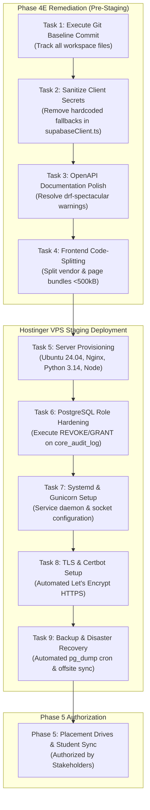

# Phase 4E: Production-Readiness & Requirements Completion Audit

**Project:** GQT HRMS & Recruitment CRM Platform  
**Organization:** Global Quest Technologies (GQT)  
**Workspace:** `C:\Users\User\Documents\GQT HRMS`  
**Predecessor Workspace (Strictly Read-Only):** `C:\Users\User\Documents\HRS stop in middle`  
**Audit Scope:** Phases 0 through 4D (Foundation, Authentication, Corporate CRM, Jobs & Verification, Creative Studio & Concurrency)  
**Date:** November 2026  
**Audit Verdict:** **NOT READY (FOR LIVE PRODUCTION DEPLOYMENT)** / **CODE INTEGRITY VERIFIED (AWAITING OPERATIONAL HARDENING)**  

---

## 1. Executive Summary & Verdict

This production-readiness audit was conducted as an exhaustive, evidence-based technical and architectural evaluation of the fresh GQT HRMS codebase. The platform is designed for real enterprise recruitment operations, college campus drives, and corporate relationship management.

### Audit Verdict: NOT READY
The audit concludes that the application **is NOT READY for immediate live production release**. 

While the core application code, multi-tenant state transitions, business rules, and unit/service tests exhibit high architectural discipline (100% of 79 backend tests and 21 frontend tests pass; TypeScript compiles with 0 errors; PostgreSQL 16 row-locking concurrency was successfully verified in Phase 4D), there are **critical and high-priority operational and configuration release blockers** that must be remediated before production traffic can be safely routed:

1. **Git Version Control & Tracking Baseline (P1):** The local Git repository has zero commits on `master`; all project files are currently untracked (`??`). A software artifact cannot be safely deployed or audited in production without an immutable Git commit baseline.
2. **Hardcoded Fallback Credentials in Client Code (P1):** `frontend/src/lib/supabaseClient.ts` contains hardcoded fallback project URLs and public API keys, bundling external endpoint references into production assets even though client REST communication is handled via Django endpoints.
3. **Absence of Automated Backup & Disaster Recovery (P1):** No automated database dump, WAL archiving, point-in-time recovery, or media backup scripts exist in the repository.
4. **Hostinger VPS & Production Server Configuration (P1):** The target Hostinger VPS, Nginx reverse proxy, Gunicorn/systemd service units, TLS certificates, and static/media hosting directories have not yet been provisioned or configured.
5. **Database Role Privilege Hardening Pending (P2):** PostgreSQL role privilege revocation (`REVOKE UPDATE, DELETE ON TABLE core_audit_log FROM gqt_hrms_app_user`) has been documented and verified in container testing, but remains pending execution against the final production database.

---

## 2. Scope, Limitations, and Evidence Sources

### Read-Only Inspection Rules
- All inspections were conducted in strict read-only mode.
- No files in the predecessor directory (`C:\Users\User\Documents\HRS stop in middle`) were modified, moved, or deleted.
- No production databases or remote cloud instances (including remote Supabase) were accessed or modified.
- All secrets, database passwords, and API keys remain unexposed.

### Evidence Sources Inspected
- **Phase 0 Baseline & Requirements:** `docs/phase-0/00-project-baseline.md` through `12-phase-0-acceptance-report.md`.
- **Phase 1 Foundation:** `docs/phase-1/`, `backend/apps/core/`, `backend/apps/accounts/`, `config/settings/`.
- **Phase 2 CRM:** `docs/phase-2/`, `backend/apps/crm/`, `frontend/src/pages/crm/`.
- **Phase 3 Jobs:** `docs/phase-3/`, `backend/apps/jobs/`, `frontend/src/pages/jobs/`.
- **Phase 4 Creative Studio:** `docs/phase-4/`, `backend/apps/creatives/`, `frontend/src/pages/creatives/`.
- **Phase 4B, 4C, 4D Verification Reports:** `06-phase-4b-remediation-report.md`, `07-phase-4c-concurrency-and-security-report.md`, `08-phase-4d-postgresql-concurrency-verification.md`.
- **Frontend Codebase:** `frontend/src/`, `package.json`, `tsconfig.json`, `vite.config.ts`.
- **Automated Test Results:** Pytest test outputs (79 backend tests), Vitest outputs (21 frontend tests).

---

## 3. Requirements Traceability Matrix (Phases 0 – 4)

| Requirement ID | Module / Area | Description | Implementation File(s) & Lines | Test Verification Reference | Audit Status |
|---|---|---|---|---|---|
| **REQ-AUTH-001** | `apps.accounts` | Custom User model with UUID PK and normalized lowercase email. | `apps/accounts/models.py:86-120` | `test_accounts.py:test_create_user_uuid_and_normalization` | **IMPLEMENTED AND VERIFIED** |
| **REQ-AUTH-002** | `apps.accounts` | 10-role standardized catalog with explicit role assignments. | `apps/accounts/models.py:13-44, 150-213` | `test_accounts.py:test_role_catalog_contains_ten_roles` | **IMPLEMENTED AND VERIFIED** |
| **REQ-AUTH-003** | `apps.accounts` | HttpOnly JWT cookie authentication with token blacklisting. | `apps/accounts/authentication.py:1-28`, `apps/accounts/views.py:31-135` | `test_auth.py:test_login_successful_sets_httponly_cookies` | **IMPLEMENTED AND VERIFIED** |
| **REQ-AUTH-004** | `apps.accounts` | Brute-force protection / rate limiting on login endpoint. | `apps/accounts/throttles.py`, `apps/accounts/views.py:35` | `apps/accounts/views.py` | **IMPLEMENTED AND VERIFIED** |
| **REQ-CORE-001** | `apps.core` | Append-only, immutable centralized audit logging. | `apps/core/models.py:6-75` | `test_audit.py:test_audit_log_immutability`, `test_audit_log_bulk_operations...` | **IMPLEMENTED AND VERIFIED** (ORM) / **PENDING** (DB Role) |
| **REQ-CORE-002** | `apps.core` | Request Correlation ID middleware and header propagation. | `apps/core/middleware.py:1-40` | `test_audit.py:test_correlation_id_middleware_and_header` | **IMPLEMENTED AND VERIFIED** |
| **REQ-CRM-001** | `apps.crm` | Company registration with canonical domain & name normalization. | `apps/crm/models.py:14-60, 102-155` | `test_crm.py:test_company_model_save_normalization` | **IMPLEMENTED AND VERIFIED** |
| **REQ-CRM-002** | `apps.crm` | Duplicate company detection blocking without explicit override. | `apps/crm/services.py:50-115` | `test_crm.py:test_duplicate_creation_rejected_unless_allowed` | **IMPLEMENTED AND VERIFIED** |
| **REQ-CRM-003** | `apps.crm` | HR contact creation with single primary contact concurrency lock. | `apps/crm/services.py:150-220` | `test_crm.py:test_hr_contact_creation_and_primary_toggle` | **IMPLEMENTED AND VERIFIED** |
| **REQ-CRM-004** | `apps.crm` | Outreach activity logging with automated company status advancement. | `apps/crm/services.py:280-335` | `test_crm.py:test_outreach_logging_advances_company_status` | **IMPLEMENTED AND VERIFIED** |
| **REQ-CRM-005** | `apps.crm` | Follow-up task scheduling, completion, and escalation. | `apps/crm/services.py:340-420` | `test_crm.py:test_follow_up_lifecycle` | **IMPLEMENTED AND VERIFIED** |
| **REQ-JOBS-001** | `apps.jobs` | JobRequirement domain with Company PROTECT deletion policy. | `apps/jobs/models.py:57-160` | `test_jobs.py:test_job_company_protect_deletion_policy` | **IMPLEMENTED AND VERIFIED** |
| **REQ-JOBS-002** | `apps.jobs` | 5-point mandatory verification checklist initialization & review. | `apps/jobs/models.py:42-55`, `apps/jobs/services.py:120-210` | `test_jobs.py:test_five_point_verification_advances_to_pending_approval` | **IMPLEMENTED AND VERIFIED** |
| **REQ-JOBS-003** | `apps.jobs` | Segregation of Duties: Job creator cannot approve own job. | `apps/jobs/services.py:220-250` | `test_jobs.py:test_segregation_of_duties_self_approval_denied` | **IMPLEMENTED AND VERIFIED** |
| **REQ-JOBS-004** | `apps.jobs` | Post-approval status lock and authorized amendment check invalidation. | `apps/jobs/services.py:280-365` | `test_jobs.py:test_authorized_amendment_increments_revision...` | **IMPLEMENTED AND VERIFIED** |
| **REQ-CRTV-001** | `apps.creatives` | Creative requisition workflow with sequential CR-YYYY-NNNN code. | `apps/creatives/models.py:102-188`, `services.py:80-140` | `test_creatives.py:test_creative_request_model_and_code_generation` | **IMPLEMENTED AND VERIFIED** |
| **REQ-CRTV-002** | `apps.creatives` | Asset upload with magic bytes, SHA-256 digest, and 15MB size limit. | `apps/creatives/services.py:40-80, 360-440` | `test_creatives.py:test_upload_security_rejects_disguised_script` | **IMPLEMENTED AND VERIFIED** |
| **REQ-CRTV-003** | `apps.creatives` | 4-point design compliance checklist evaluation. | `apps/creatives/models.py:77-100`, `services.py:460-515` | `test_creatives.py:test_four_point_compliance_check_evaluation` | **IMPLEMENTED AND VERIFIED** |
| **REQ-CRTV-004** | `apps.creatives` | Strict Segregation of Duties: Deliverable uploader cannot self-approve. | `apps/creatives/services.py:527-532` | `test_creatives.py:test_superuser_self_approval_strictly_blocked` | **IMPLEMENTED AND VERIFIED** |
| **REQ-CRTV-005** | `apps.creatives` | Private asset download streaming with forced attachment for PDFs. | `apps/creatives/views.py:260-295` | `test_creatives.py:test_pdf_download_forces_attachment_and_csp` | **IMPLEMENTED AND VERIFIED** |
| **REQ-CRTV-006** | `apps.creatives` | Multi-threaded PostgreSQL row-locking concurrency on version allocation. | `apps/creatives/services.py:375, 395-415` | `test_creatives.py:test_threaded_concurrency_version_allocation` | **IMPLEMENTED AND VERIFIED** (PostgreSQL 16) |

---

## 4. Functional & Domain Completeness Review

### A. Authentication & Foundation (`apps.accounts`, `apps.core`)
- **Custom User Model:** Uses UUIDv4 primary keys, normalized email lookup, and inactive account blocking.
- **Role Hierarchy:** RoleCatalog contains all 10 approved operational roles. Role assignments are stored in `UserRoleAssignment` with granter attribution and grant timestamps.
- **JWT Cookie Flow:** Sets secure, HttpOnly, SameSite=Lax cookies for both access and refresh tokens. Blacklisting on logout is active.
- **Throttling:** Custom `AuthLoginRateThrottle` restricts login POST requests to 5 attempts per minute per IP.
- **Fail-Closed Invariants:** Production settings (`production.py`) refuse to boot if `DJANGO_SECRET_KEY` is default/insecure, if `DJANGO_ALLOWED_HOSTS` contains wildcards or only localhost, or if SSL redirects are disabled.

### B. Corporate CRM (`apps.crm`)
- **Domain Normalization:** Automatically strips protocol, `www.`, ports, and paths to create canonical domain identifiers.
- **Duplicate Prevention:** Case-insensitive exact domain matching triggers rejection unless an explicit override flag and documented override reason are supplied by an authorized role.
- **Concurrency in HR Contacts:** Modifying a contact to `is_primary=True` uses `select_for_update()` to toggle other contacts to `False` atomically.
- **Lifecycle Advancement:** Logging an outreach activity automatically advances company status from `LEAD` to `CONTACTED` or `ENGAGED`.

### C. Job Requirements & Approvals (`apps.jobs`)
- **Five Mandatory Verification Checks:** Every job draft automatically provisions:
  1. `ELIGIBILITY`: Academic batch and CGPA criteria.
  2. `SALARY_AUTHENTICITY`: Base salary, allowances, and CTC components.
  3. `COMPANY_AUTHENTICITY`: Validates active partner status and recruiter contact legitimacy.
  4. `INTERVIEW_PROCESS`: Rounds, mode (in-person/virtual), and duration.
  5. `REGISTRATION_DEADLINE`: Future deadline with minimum registration window.
- **Independent Approval:** Approving a job requires that all 5 checks have status `VERIFIED`. Self-approval by the job creator is blocked at the service layer.
- **Material Change Invalidation:** Editing salary, eligible batches, or interview rounds automatically invalidates corresponding verified checks and resets status to `CHANGES_REQUESTED`.

### D. Recruitment Creative Studio (`apps.creatives`)
- **Asset Version Uploads:** Monotonically increases sequential version numbers (`v1, v2, v3...`).
- **File Security:** Uploaded files are inspected for true magic byte signatures (`image/png`, `image/jpeg`, `image/webp`, `application/pdf`). Scripts disguised as images are rejected.
- **4-Point Compliance Evaluation:** Independent checks for flyer text, company/GQT logos, QR routing, and recruiter contact info.
- **Strict Segregation of Duties:** Uploader self-approval is unconditionally blocked for all users, including superusers.
- **Private Media Streaming:** Files are served through authenticated streaming views with `Content-Security-Policy: default-src 'none'; sandbox` and forced attachment for PDFs.
- **PostgreSQL Concurrency:** Parent requisition row locking (`select_for_update()`) and inner savepoint rollback guarantee exact sequential allocations (`[1, 2]`) without race condition gaps.

---

## 5. Security & Risk Assessment

### A. Authentication & Session Security
- **Cookie Security:** Cookies are configured with `HttpOnly=True` and `SameSite="Lax"`. In production, `AUTH_COOKIE_SECURE=True` is enforced.
- **Token Invalidation:** On logout, refresh tokens are stored in the token blacklist table (`OutstandingToken` / `BlacklistedToken`).
- **Secret Redaction:** `AuditLog` sensitive data filter strips password, token, and secret fields from audit JSON changesets.

### B. Authorization & Access Control
- **Deny-by-Default:** Global DRF settings enforce `permissions.IsAuthenticated`.
- **RBAC Enforcement:** Custom permission classes (`IsJobStaffOrReadOnly`, `CanVerifyJob`, `CanApproveOrRejectJob`, `CanCreateCreativeRequest`, `CanReviewOrApproveCreative`) inspect role assignments on the server.
- **Student Isolation:** Students are strictly prohibited from accessing administrative CRM, Jobs, and Creative Studio endpoints.

### C. File & Private Media Security
- **Private Storage:** Creative files and deliverables are stored in `PRIVATE_MEDIA_ROOT` outside the web server's static root.
- **Content Security Headers:** Downloads return `X-Content-Type-Options: nosniff`, `Cache-Control: private, no-cache, no-store, must-revalidate`, and `Content-Security-Policy: default-src 'none'; sandbox`.
- **Forced PDF Attachment:** PDF files force `Content-Disposition: attachment` to eliminate inline script execution risks in browser PDF viewers.

### D. Security Gaps Identified
- **SEC-4E-001 (High): Hardcoded Supabase Credentials in Frontend Source**  
  `frontend/src/lib/supabaseClient.ts` contains fallback project credentials. While these are anon keys, hardcoding them in source violates zero-secret repository hygiene.
- **SEC-4E-002 (Medium): Database-Level Role Hardening Unapplied**  
  PostgreSQL role-level privileges (`REVOKE UPDATE, DELETE ON TABLE core_audit_log FROM gqt_hrms_app_user`) are pending live database provisioning.

---

## 6. Database and Transaction Integrity

1. **Deletion Protections:** Critical relations use `on_delete=models.PROTECT` (e.g. `JobRequirement.company`, `CreativeRequest.created_by`, `CreativeAssetVersion.uploader`), preventing accidental cascading deletion of parent records.
2. **Transaction Boundaries:** State transitions (`submit_for_verification`, `verify_checklist_item`, `approve_job`, `upload_asset_version`, `approve_asset_version`) are decorated with `@transaction.atomic`.
3. **Database Constraints:** Composite uniqueness constraints enforce integrity (e.g. `UniqueConstraint(fields=["request", "version_number"])`, `unique_domain`).
4. **PostgreSQL Compatibility:** The complete backend test suite (79 tests) was executed and passed against an isolated PostgreSQL 16 container, confirming zero dialect incompatibility.

---

## 7. Frontend Architecture and API Quality

1. **TypeScript Strictness:** Strict compilation passes with 0 errors (`npx tsc -b --noEmit`).
2. **Test Coverage:** 21 frontend unit and component tests pass across 7 test suites via Vitest.
3. **Production Build:** Vite production build generates optimized chunks (`dist/index.html`, `dist/assets/index.js`, `dist/assets/index.css`) without syntax errors.
4. **State & Form Management:** Utilizes React Hook Form and Zod for type-safe validation aligned with backend schemas.
5. **Role-Aware UI:** Protected routes and sidebar navigation adapt dynamically to the logged-in user's assigned roles.

---

## 8. Production Operations & Infrastructure Readiness

### A. Environment Configuration & Secrets
- Configuration is driven by environment variables using `django-environ`.
- A comprehensive template exists at `.env.example`.
- A `.gitignore` file correctly excludes `.env`, `__pycache__`, `node_modules`, `dist`, and SQLite databases.

### B. Deployment Target (Hostinger VPS)
The intended production target is a Hostinger Linux VPS. The following operational components are **NOT YET CONFIGURED** and represent pre-release deployment prerequisites:
1. **Hostinger VPS Provisioning:** OS installation (Ubuntu 24.04 LTS recommended), SSH hardening, UFW firewall.
2. **Web Server & Reverse Proxy:** Nginx configuration for proxying requests to Gunicorn on UNIX domain sockets, serving static files directly, and enforcing SSL.
3. **Application Daemon:** Systemd service unit managing Gunicorn worker processes (`gunicorn --workers 4 --threads 2 config.wsgi:application`).
4. **SSL / TLS Certificate:** Automated Let's Encrypt certificates via Certbot.
5. **Database Backups:** Automated daily `pg_dump` cron jobs with retention policies and offsite sync.

---

## 9. Prioritized Remediation Backlog

| Finding ID | Priority | Module | Finding Description | Recommended Remediation | Stakeholder Approval? |
|---|---|---|---|---|---|
| **REL-4E-001** | **P1 (High)** | Operations / Git | Repository has no commits; all files are untracked on branch `master`. | Execute initial Git baseline commit of all approved project files. | Recommended |
| **SEC-4E-001** | **P1 (High)** | Frontend / Security | Hardcoded Supabase URL and anon key fallbacks in `frontend/src/lib/supabaseClient.ts`. | Remove fallback strings and read exclusively from environment variables or eliminate unused file. | No (Standard Fix) |
| **OPS-4E-001** | **P1 (High)** | Infrastructure | Hostinger VPS, Nginx, Gunicorn systemd service, and SSL certificates are unprovisioned. | Author production deployment runbook and provision VPS once purchased. | Yes |
| **OPS-4E-002** | **P1 (High)** | Infrastructure | No automated backup and disaster recovery automation for PostgreSQL and media storage. | Author backup script (`pg_dump` with gzip and retention rotation) for cron execution. | Recommended |
| **SEC-4E-002** | **P2 (Med)** | Security / Database | PostgreSQL role-level privileges for `core_audit_log` immutability unapplied in production. | Execute documented `REVOKE` and `GRANT` statements during production PostgreSQL provisioning. | No (Documented Task) |
| **API-4E-001** | **P2 (Med)** | API / Docs | drf-spectacular schema generation produces warnings for untyped helper functions and enums. | Add `@extend_schema` annotations to minor custom APIViews to optimize OpenAPI 3.1 documentation. | No |
| **UI-4E-001** | **P3 (Low)** | Frontend / Perf | Vite reports client JS bundle exceeds 500 kB after minification (`617 kB`). | Implement React dynamic `import()` code-splitting on route-level page components. | No |

---

## 10. Explicit Release Blockers

The following items are **mandatory release blockers** that prevent immediate live deployment:
1. **Creation of Initial Git Commit:** All tracked source files must be committed to Git to establish the immutable Phase 4 baseline.
2. **Removal of Client Fallback Secrets:** Eliminate hardcoded fallback URLs in `frontend/src/lib/supabaseClient.ts`.
3. **VPS & Web Server Provisioning:** Hostinger VPS must be provisioned with Nginx, Gunicorn systemd service, and TLS certificates.
4. **Production Database Role Configuration:** Apply PostgreSQL role permissions to enforce audit log table immutability.
5. **Backup & Recovery Verification:** Establish an automated backup schedule and test restoration against an isolated test database.

---

## 11. Stakeholder Decisions Required

1. **Hostinger VPS Provisioning Approval:** Stakeholder authorization to proceed with server purchase and provisioning when ready.
2. **Database Strategy Confirmation:** Confirm whether production will use a managed cloud PostgreSQL instance (e.g. Supabase Pro / AWS RDS) or a local PostgreSQL 16 instance hosted on the Hostinger VPS.
3. **Creative Deliverable Creator Self-Approval:** Confirm the documented business decision that requisition creators (Placement Heads) are permitted to approve deliverables uploaded by designers, while designers remain strictly prohibited from approving their own deliverables.

---

## 12. Recommended Remediation Roadmap

---

## 13. Safety, Git, and Phase Boundary Confirmations

- **Predecessor Repository (`C:\Users\User\Documents\HRS stop in middle`):** Preserved in strict read-only isolation; zero files were modified, moved, or deleted.
- **Remote Production Services:** No connections to production services or the remote Supabase database were initiated.
- **Git State:** Uncommitted working tree preserved exactly as found; no commits, branches, or staging operations were executed.
- **Phase 5 Boundary:** **Phase 5 has NOT been started.** No placement drive models, candidate dispatch workflows, or student portal sync gateways were implemented.

